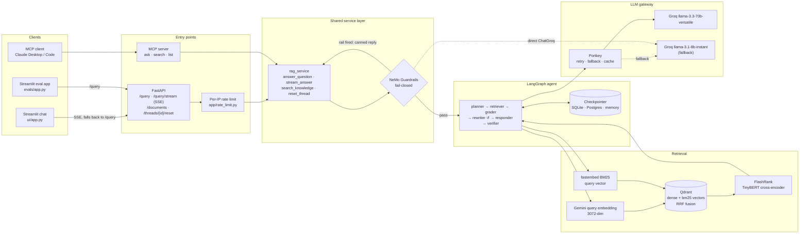
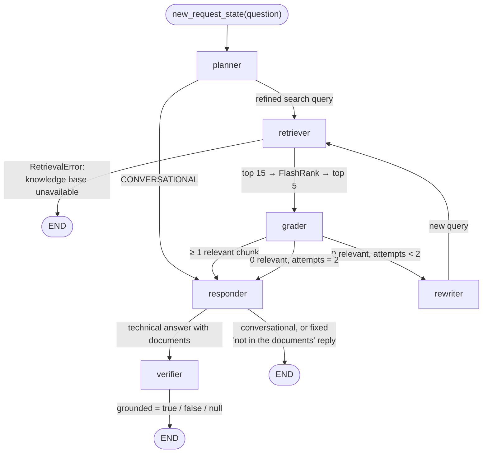
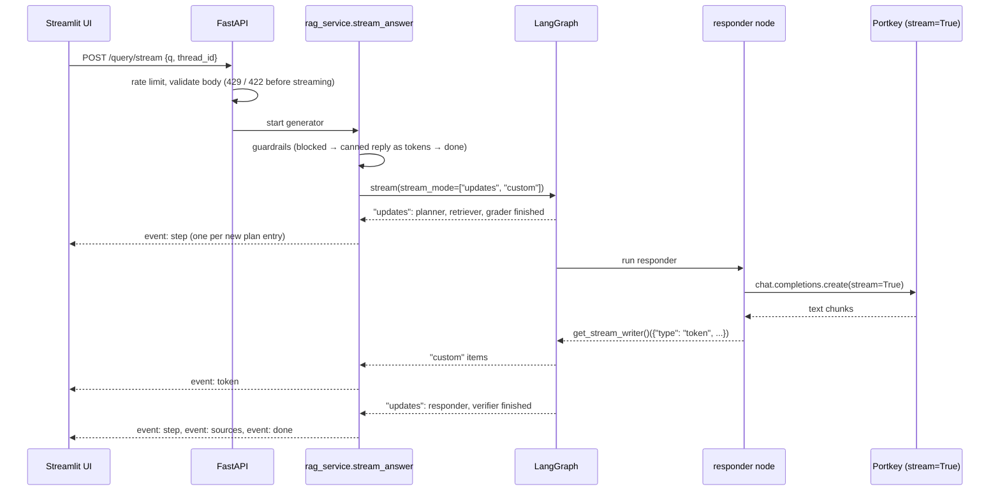
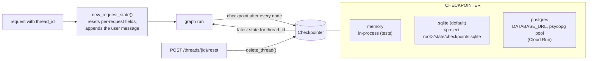
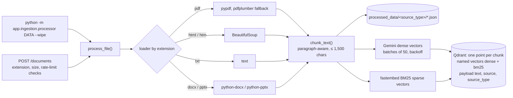
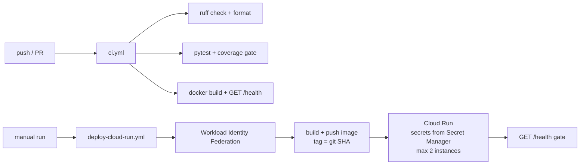
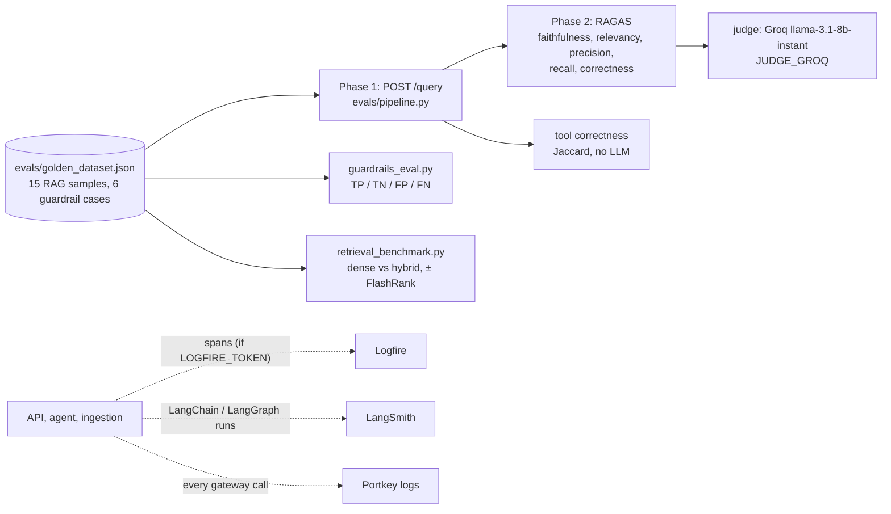

# Architecture

Diagrams of the current system. Node and module names match the code: `app/agents/graph.py`, `app/services/rag_service.py`, `app/main.py`, `app/mcp_server.py`.

## 1. System overview

The API and the MCP server never call the agent directly. Both go through `rag_service`, so guardrails, the per-request state reset, the thread config and the response shape are written once. `/query` and `/query/stream` run the same helpers: `/query` calls `graph.invoke()`, while `/query/stream` calls `graph.stream(stream_mode=["updates", "custom"])`.

## 2. Agent graph (self-correcting mode, the default)

| Node | Module | LLM call | Writes |
|---|---|---|---|
| `planner` | `nodes/planner.py` | Portkey (LangChain `ChatOpenAI`) | `current_query` (search query or `CONVERSATIONAL`), `plan` |
| `retriever` | `nodes/retriever.py` | none (Gemini + BM25 embeddings, Qdrant, FlashRank) | `documents`, `retrieval_attempts`, or `retrieval_error` + the unavailable answer |
| `grader` | `nodes/grader.py` | one batched call for all chunks; fails open | `documents` (relevant only) |
| `rewriter` | `nodes/rewriter.py` | one small call; falls back to the original question | `current_query` |
| `responder` | `nodes/responder.py` | Portkey native client (`stream=True` on `/query/stream`); none for the no-evidence reply | `final_answer`, `messages`, `status` |
| `verifier` | `nodes/verifier.py` | one call; labels the answer, never changes it | `grounded` |

The routing functions are pure and live in `app/agents/routing.py`. With `ENABLE_SELF_CORRECTION=false` the graph is `planner → (retriever) → responder → END`, with no grader, rewriter or verifier.

## 3. Streaming (`POST /query/stream`)

Answers that aren't written by the LLM (guardrail reply, "knowledge base unavailable", "not in the documents") are sent as word-sized `token` events after the graph finishes. Any exception becomes a single `error` event with a generic message. The UI falls back to `POST /query` only if the stream can't be opened or delivers nothing.

## 4. Conversation memory

The checkpointer is opened by the FastAPI lifespan at startup (an invalid `CHECKPOINTER` fails startup; Postgres runs `setup()` here) and closed on shutdown. The MCP server opens it lazily on first use.

## 5. Ingestion

`ensure_collection()` is the only code that creates the collection. A collection with the old single-vector schema is refused (CLI error, HTTP 409 on upload) instead of mixing formats.

## 6. Delivery

## 7. Evaluation and observability

