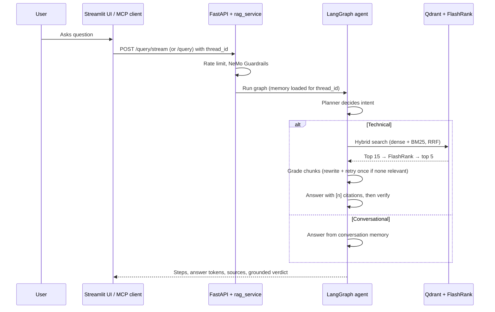

# 🤖 Enterprise Agentic RAG: System Overview

A RAG service for technical documents built on **LangGraph**. It retrieves evidence with hybrid search, checks that evidence before answering, cites it, and verifies the answer against it.

---

## 🌟 Vision
Many RAG systems treat every query the same. This agent first distinguishes between:
1.  **Conversational queries**: "Hi", "What did I just ask?" These are answered from conversation memory, with no search.
2.  **Technical queries**: "How do I limit retries of a Kubernetes Job?" These are answered only from the indexed documents.

For technical queries it doesn't trust the first search blindly. A grader drops irrelevant chunks, a rewriter retries once with a better query, and a verifier checks the final answer against the sources. When the documents don't cover a question, the agent says so instead of answering from general knowledge.

---

## 🏗️ High-Level Flow

---

## 📂 Project Organization
*   **`app/`**: the API (`main.py`), the shared service layer (`services/rag_service.py`), the agent (`agents/`), retrieval, ingestion, guardrails, gateway and the MCP server.
*   **`ui/`**: the Streamlit chat and upload interface.
*   **`evals/`**: the golden dataset, RAGAS pipeline and retrieval benchmark.
*   **`DATA/`**: the sample corpus (`true_data` answers; the `noisy_data` distractors are not distributed with the repository — see [DATA/README.md](../DATA/README.md)).
*   **`DOCS/`**: this documentation suite. Commands are in the [README](../README.md).

---

## 🚀 Quick Navigation
1.  **Ingestion**: [02_INGESTION_ENGINE.md](02_INGESTION_ENGINE.md)
2.  **Intelligence**: [03_NODE_INTELLIGENCE.md](03_NODE_INTELLIGENCE.md)
3.  **Observability**: [04_TRACING_AND_OBSERVABILITY.md](04_TRACING_AND_OBSERVABILITY.md)
4.  **Environment Variables**: [05_ENVIRONMENT_VARIABLES.md](05_ENVIRONMENT_VARIABLES.md)
5.  **Architecture diagrams**: [../ARCHITECTURE.md](../ARCHITECTURE.md)
