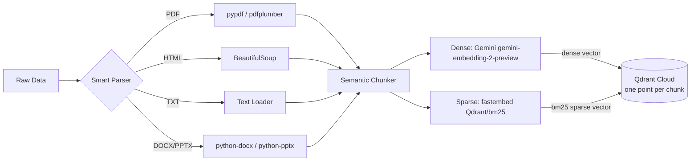

# 📥 Ingestion Engine: Data to Knowledge

The Ingestion Engine is a modular, high-performance pipeline designed to convert raw enterprise data into a searchable vector format.

## 🔄 The Pipeline Flow


---

## 🛠️ Technical Specifications

### 1. Smart Parsing (Local, No External OCR)
All document parsing runs entirely on-device — no external OCR service or cloud API is required:
*   **PDFs**: Parsed locally via **pypdf** (primary) and **pdfplumber** (fallback for complex layouts). Handles multi-page PDFs without any page-count limits.
*   **HTML**: Processed via **BeautifulSoup**. It intelligently strips out `<script>`, `<style>`, and metadata tags to extract only the readable content.
*   **Office Docs**: Supports `.docx` via `python-docx` and `.pptx` via `python-pptx`.
*   **Plain Text**: Loaded directly with a simple text reader.

### 2. Semantic Chunking
*   **Chunk Size**: `1500` characters.
*   **Overlap**: Natural overlap (we split by paragraph breaks `\n\n` rather than arbitrary character counts).
*   **Logic**: The system uses a semantic-ish, paragraph-aware splitter. It attempts to keep paragraphs together to maintain context, ensuring that no chunk is cut off mid-sentence whenever possible. This prevents the LLM from getting "hallucinated" fragments.

### 3. Vectorization & Storage (hybrid: dense + BM25)
Every chunk is stored as **one Qdrant point with two named vectors**, so one collection serves both retrieval modes (`RETRIEVAL_MODE=hybrid` or `dense`):

| Named vector | Type | Produced by | Config |
|---|---|---|---|
| `dense` | dense, 3072-dim (768 with the local fallback) | Gemini `gemini-embedding-2-preview` | `Distance.COSINE` |
| `bm25` | sparse (term id → weight) | fastembed `SparseTextEmbedding("Qdrant/bm25")` | `SparseVectorParams(modifier=Modifier.IDF)` |

*   **Dense vector**: captures meaning ("retry limit" ≈ "backoffLimit"), batched 50 chunks per Gemini call with exponential backoff on rate limits.
*   **BM25 sparse vector**: captures exact terms (`backoffLimit`, `parallelism`, `--dry-run`, `job-wq-2`). fastembed tokenises, lower-cases, removes stopwords and stems, then stores each term's BM25 term-frequency weight (with document-length normalisation). It runs locally on CPU (ONNX/tokenizers, **no PyTorch**), in batches of 64 chunks.
*   **IDF is computed by Qdrant**, not stored: `Modifier.IDF` makes Qdrant apply inverse document frequency at query time from the live collection statistics, so IDF stays correct as documents are added or uploaded.
*   **Payload** (unchanged): `text`, `source`, `source_type` (`true`, `noisy`, `uploaded`, …).
*   **Both paths write both vectors**: the CLI ingestion and the `/documents` upload go through the same `process_file()` → `build_points()`.

### 4. One collection schema, created in one place
`ensure_collection()` in `app/services/retrieval/qdrant_service.py` is the only code that creates the collection, and the ingestion module and the retriever share one lazily created Qdrant client (`get_qdrant_client()`). Importing `app.ingestion.processor` has no side effects: Logfire is configured, and the Qdrant client and embedding models are created, only when ingestion actually runs.

If the collection exists with the **old unnamed-vector schema** (created before hybrid search), ingestion and search refuse to mix formats and fail with:

```
Collection uses the old schema — re-ingest with: python -m app.ingestion.processor DATA --wipe
```

The CLI exits with this message, `/documents` returns HTTP 409 with it, and at query time the agent reports "Knowledge base unavailable" (the message is in the logs).

---

## 🌍 Universal Ingestion Command
The engine is "Universal," meaning it automatically detects folder structures and maps them to metadata (e.g., "True" vs "Noisy" data).

```powershell
# Command to run the full ingestion (drops and recreates the collection with the hybrid schema)
python -m app.ingestion.processor DATA --wipe
```

`--wipe` is required once when upgrading from the dense-only schema. The BM25 model (a few MB) is downloaded on first use to `FASTEMBED_CACHE_PATH` (default: a temp directory).
