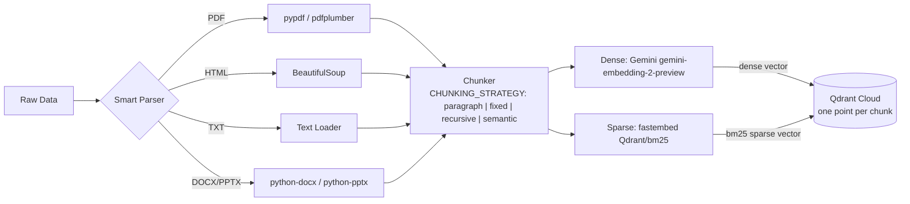

# 📥 Ingestion Engine: Data to Knowledge

The Ingestion Engine is a modular, high-performance pipeline designed to convert raw enterprise data into a searchable vector format.

## 🔄 The Pipeline Flow


---

## 🛠️ Technical Specifications

### 1. Smart Parsing (Local, No External OCR)
All document parsing runs entirely on-device — no external OCR service or cloud API is required:
*   **PDFs**: Parsed locally via **pypdf**; pages where pypdf returns no text are retried with **pdfplumber**. There is no OCR, so fully image-based PDFs yield no text and are skipped.
*   **HTML**: Processed via **BeautifulSoup**. It intelligently strips out `<script>`, `<style>`, and metadata tags to extract only the readable content.
*   **Office Docs**: Supports `.docx` via `python-docx` and `.pptx` via `python-pptx`.
*   **Plain Text**: Loaded directly with a simple text reader.

### 2. Chunking strategies
Chunking is configurable with three environment variables (validated at API startup and before `processor --wipe` touches Qdrant; an invalid value fails with a message naming the variable):

| Variable | Default | Values |
|---|---|---|
| `CHUNKING_STRATEGY` | `paragraph` | `paragraph`, `fixed`, `recursive`, `semantic` |
| `CHUNK_SIZE` | `1500` | maximum characters per chunk (> 0) |
| `CHUNK_OVERLAP` | `0` | characters repeated between consecutive chunks; `< CHUNK_SIZE`; `fixed` and `recursive` only |

The defaults reproduce the original chunker. They stay until the chunking experiment (below) picks a winner. Every strategy has the same interface, `chunker(text, chunk_size, chunk_overlap) -> list[str]` (`app/ingestion/chunking/`), and the same guarantees, enforced by `tests/test_chunking.py`: no chunk longer than `CHUNK_SIZE`, no empty chunks, no word lost, a word longer than the limit is hard-split.

| Strategy | Module | How it splits | Overlap |
|---|---|---|---|
| `paragraph` | `splitter.py` | Packs whole paragraphs (`\n\n`) up to the size; a longer paragraph is cut at the last space before the limit. | no |
| `fixed` | `fixed.py` | Character windows of `CHUNK_SIZE`, each ending at the last whitespace before the limit. | yes, word-aligned |
| `recursive` | `recursive.py` | Splits on `\n\n`, then `\n`, then `. `, then space, then characters, only where a piece is still too long, then merges neighbouring pieces up to the size (the idea of LangChain's `RecursiveCharacterTextSplitter`, implemented in-house: no extra dependency). | yes, a word-aligned tail of the previous chunk |
| `semantic` | `semantic.py` | Splits into sentences (`. ! ?` and line breaks), embeds each one, and starts a new chunk where the cosine similarity between neighbours falls below the document's 10th percentile (once the chunk holds half of `CHUNK_SIZE`), or where the size would be exceeded. | no |

Notes:
*   The parsers emit **no blank lines** for DOCX and HTML (one line per paragraph), so `paragraph` sees each such document as one long paragraph and effectively cuts fixed-size windows at spaces.
*   `semantic` embeds **every sentence** at ingestion with the same embedder as the chunks (Gemini in production, about 10-20x more embedding calls than chunks), so it is the slowest and most expensive strategy to ingest.
*   Changing the strategy only affects newly ingested documents. Re-ingest with `--wipe` so the collection doesn't mix strategies.

**Chunking experiment.** `python -m evals.chunking_experiment` compares the strategies × sizes {500, 1000, 1500} × overlaps {0, 15%} on the 15 golden questions. Each configuration is indexed into a temporary in-memory Qdrant (never Qdrant Cloud) with the production hybrid + FlashRank pipeline, using a free local embedder by default (`--embedder local`: sentence-transformers `all-MiniLM-L6-v2`; `--embedder gemini` for the production model). Results, findings and the recommended default: [`evals/results/chunking_experiment.md`](../evals/results/chunking_experiment.md). sentence-transformers (PyTorch) is only in `requirements.txt`, not in the production image.

### 3. Vectorization & Storage (hybrid: dense + BM25)
Every chunk is stored as **one Qdrant point with two named vectors**, so one collection serves both retrieval modes (`RETRIEVAL_MODE=hybrid` or `dense`):

| Named vector | Type | Produced by | Config |
|---|---|---|---|
| `dense` | dense, 3072-dim (768 with the local fallback) | Gemini `gemini-embedding-2-preview` | `Distance.COSINE` |
| `bm25` | sparse (term id → weight) | fastembed `SparseTextEmbedding("Qdrant/bm25")` | `SparseVectorParams(modifier=Modifier.IDF)` |

*   **Dense vector**: captures meaning ("retry limit" ≈ "backoffLimit"), batched 50 chunks per Gemini call with exponential backoff on rate limits.
*   **BM25 sparse vector**: captures exact terms (`backoffLimit`, `parallelism`, `--dry-run`, `job-wq-2`). fastembed tokenises, lower-cases, removes stopwords and stems, then stores each term's BM25 term-frequency weight (with document-length normalisation). It runs locally on CPU (ONNX/tokenizers, **no PyTorch**), in batches of 64 chunks.
*   **IDF is computed by Qdrant**, not stored: `Modifier.IDF` makes Qdrant apply inverse document frequency at query time from the live collection statistics, so IDF stays correct as documents are added or uploaded.
*   **Payload**: `text`, `source`, `source_type` (`true`, `noisy`, `uploaded`, …), plus how the chunk was made: `chunk_index` (position in its document), `chunking_strategy`, `chunk_size`, `chunk_overlap`.
*   **`processed_data/<source_type>/<file>.json`**: `filename`, `source_type`, `chunking` (`chunking_strategy`, `chunk_size`, `chunk_overlap`) and `chunks`, a list of strings whose position is the `chunk_index` (kept as plain strings so `list_indexed_documents` and older snapshots keep working).
*   **Both paths write both vectors**: the CLI ingestion and the `/documents` upload go through the same `process_file()` → `build_points()`.

### 4. One collection schema, created in one place
`ensure_collection()` in `app/services/retrieval/qdrant_service.py` is the only code that creates the collection, and the ingestion module and the retriever share one lazily created Qdrant client (`get_qdrant_client()`). Importing `app.ingestion.processor` has no side effects: Logfire is configured, and the Qdrant client and embedding models are created, only when ingestion actually runs.

If the collection exists with the **old unnamed-vector schema** (created before hybrid search), ingestion and search refuse to mix formats and fail with:

```
Collection uses the old schema — re-ingest with: python -m app.ingestion.processor DATA --wipe
```

The CLI exits with this message, `/documents` returns HTTP 409 with it, and at query time the agent reports "Knowledge base unavailable" (the message is in the logs).

---

## 🌍 Universal Ingestion Command
The engine is "Universal," meaning it automatically detects folder structures and maps them to metadata (e.g., "True" vs "Noisy" data).

```powershell
# Command to run the full ingestion (drops and recreates the collection with the hybrid schema)
python -m app.ingestion.processor DATA --wipe
```

`--wipe` is required once when upgrading from the dense-only schema. The BM25 model (a few MB) is downloaded on first use to `FASTEMBED_CACHE_PATH` (default: a temp directory).
