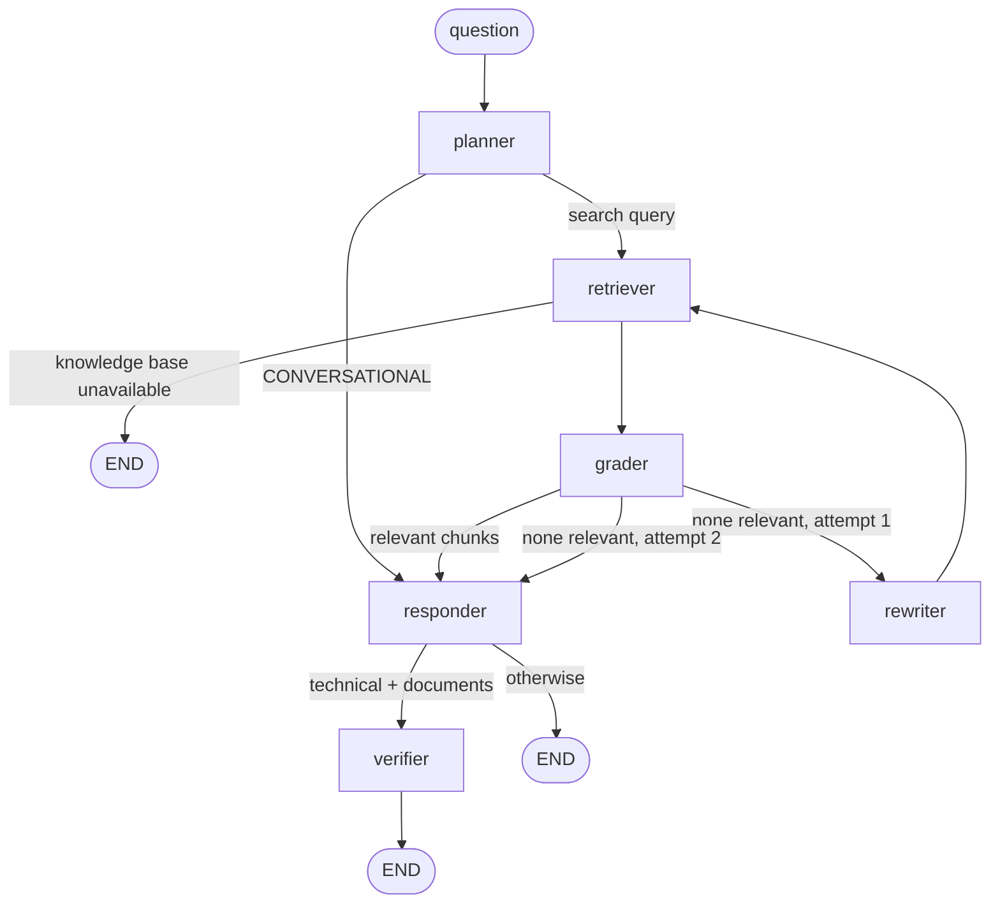

# 🧠 Node Intelligence: The Agentic Brain

The agent is a **LangGraph state machine** (`app/agents/graph.py`) with a corrective loop. It decides whether a search is needed, checks whether what it found is relevant, retries once with a better query if not, and verifies its own answer. All routing decisions are pure functions in `app/agents/routing.py`, so they are unit-tested without any LLM.

---

## 🤖 The Graph Nodes

All LLM calls except the guardrails go through the Portkey gateway: primary Groq `llama-3.3-70b-versatile`, with fallback to `llama-3.1-8b-instant`.

### 1. 🧭 Planner (`nodes/planner.py`)
*   **Input**: the conversation history and the latest message.
*   **Output**: either the sentinel `CONVERSATIONAL` (a greeting, or a question answerable from the history) or a refined search query. `normalize_planner_decision()` tolerates decorated replies such as `"**Conversational.**"`.

### 2. 🔍 Retriever (`nodes/retriever.py`)
*   **Stage 1, hybrid search** (`RETRIEVAL_MODE=hybrid`, the default): the query is embedded twice, as a 3072-dim Gemini `gemini-embedding-2-preview` dense vector and as a fastembed BM25 sparse vector. One Qdrant `query_points` call prefetches the dense top 30 and the BM25 top 30 and fuses them with **Reciprocal Rank Fusion**, returning the top **15**. With `RETRIEVAL_MODE=dense` it is a dense cosine search for the top 15.
*   **Stage 2, rerank**: FlashRank, a local ONNX cross-encoder (`ms-marco-TinyBERT-L-2-v2`, FlashRank's default model), reads the query and each candidate together and keeps the top **5**. If the reranker fails, the stage-1 order is used.
*   **Outage handling**: if Qdrant or the embedding service fails, retrieval raises `RetrievalError` and the node ends the run with "Knowledge base unavailable". An outage is never treated as "no results", so it doesn't trigger a rewrite or the "not in the documents" reply.
*   Increments `retrieval_attempts`, which bounds the loop.

### 3. 🧪 Grader (`nodes/grader.py`), Corrective RAG
*   One **batched** LLM call judges all 5 chunks at once (each truncated to 1,200 characters) and replies `{"relevant": [0, 2]}`.
*   **Fails open**: if the reply can't be parsed, or the call fails, all chunks are kept. A flaky grader must never discard evidence.

### 4. ✏️ Rewriter (`nodes/rewriter.py`)
*   Runs only when the grader kept nothing and fewer than `MAX_RETRIEVAL_ATTEMPTS = 2` retrievals have run.
*   Writes one new search query (synonyms, expanded acronyms). If the rewrite is empty or identical to the failed query, it falls back to the user's original question.

### 5. ✍️ Responder (`nodes/responder.py`)
*   **Conversational**: answers from the conversation history.
*   **Technical with evidence**: answers only from the numbered context (`format_context()`, capped at 25,000 characters) and cites sources inline as `[1]`, `[2]`, matching the API's `sources` list.
*   **Technical with no relevant evidence after the retry**: returns a fixed "I couldn't find this in the indexed documents" reply. There is no LLM call, so the model can't fall back to general knowledge.
*   Uses Portkey's **native** client so it can read the `x-portkey-cache-status` header (shown as the `Cache: Hit ⚡` step). On `/query/stream` it calls the gateway with `stream=True` and pushes each token through LangGraph's stream writer.

### 6. 🔎 Verifier (`nodes/verifier.py`), Self-RAG
*   Runs only for technical answers that have evidence. It asks whether every factual claim is supported by the sources and stores `grounded = true | false | null` (null = unclear or call failed).
*   It **labels** the answer and never changes it, so a flaky verifier can only mislabel an answer, never corrupt it. The UI shows the verdict as a badge.

---

## ⛓️ Workflow Visualization

`ENABLE_SELF_CORRECTION=false` builds the original linear graph instead: `planner → (retriever) → responder → END`, with no grader, rewriter or verifier.

**Cost per technical question (self-correcting mode):** planner + grader + responder + verifier, so 4 LLM calls. When the first retrieval finds nothing relevant, add a rewriter call, a second retrieval and a second grader call. When the retry also finds nothing, the responder and verifier calls are skipped. Conversational turns cost planner + responder.

---

## 💾 State & Memory
*   **Memory**: The graph uses a LangGraph checkpointer chosen by `CHECKPOINTER` (`app/agents/checkpointer.py`): `sqlite` (default, a local file), `postgres` (shared, for Cloud Run) or `memory` (in-process). It saves the state per `thread_id` after every node, so the agent recalls previous turns on the same `thread_id`. With `sqlite` or `postgres` this survives a backend restart; with `memory` it does not. `POST /threads/{thread_id}/reset` clears one conversation.
*   **Per-request reset**: `new_request_state()` resets every field except `messages` at the start of each request, so for example `retrieval_attempts = 2` from the previous question can't skip the next question's retry.
*   **State** (`AgentState` in `app/agents/state.py`):
    *   `messages`: the full chat history (appended, never replaced).
    *   `current_query`: the search query, or `CONVERSATIONAL`.
    *   `documents`: the retrieved, reranked and graded evidence.
    *   `plan`: the visible "thought steps" (API `thought_process`, UI status panel, SSE `step` events).
    *   `status`, `final_answer`, `retrieval_attempts`, `grounded`, `retrieval_error`.
