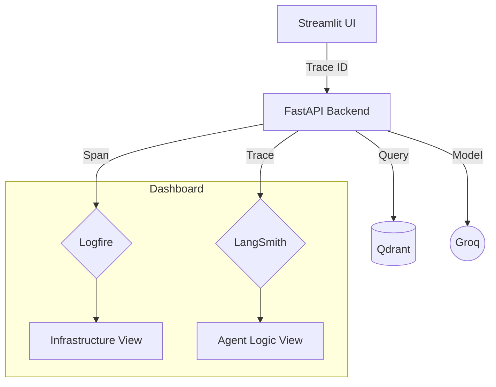

# 🕵️ Tracing & Observability

In an Agentic system, "Why did the AI say that?" is the most important question. We use a dual-tracing strategy to provide total transparency into the agent's thought process.

---

## 🔬 The Observability Stack

### 1. Pydantic Logfire (System Tracing)
Logfire records the spans and logs the code emits explicitly (`logfire.span(...)`, `logfire.info(...)`), for example:
*   **Agent steps**: planner decision, knowledge retrieval, reranking, relevance grading, query rewrite, LLM synthesis, groundedness check.
*   **Parsing steps**: which parser (pypdf, BS4, python-docx) handled which file, and chunking.
*   **Gateway events**: `⚡ Gateway Cache Hit` when Portkey served the answer from its cache.

The API calls `logfire.configure(send_to_logfire="if-token-present")`: with `LOGFIRE_TOKEN` set, spans are exported; without it, telemetry stays local and the API still starts. FastAPI auto-instrumentation (`logfire.instrument_fastapi`) is **not** enabled, so per-request latency spans come only from the code's own spans.

### 2. LangSmith (LLM Orchestration)
LangSmith is specialized for the "Agentic" part of the project. It records:
*   **Graph State Transitions**: How the state changed from node to node (planner, retriever, grader, rewriter, responder, verifier).
*   **Prompt Versions**: The exact system instructions sent to Groq.
*   **Token Usage**: Monitoring the cost and efficiency of LLM calls.
*   **Chain of Thought**: The reasoning steps the agent took before answering.

---

## 📊 Tracing Architecture

---

## 🛠️ How to access
*   **Logfire**: Visit your [Logfire Project](https://logfire.pydantic.dev/).
*   **LangSmith**: Visit your [LangSmith Project](https://smith.langchain.com/).

> [!NOTE]
> Traces are **not** linked across services. The Streamlit UI and the API configure Logfire separately, and no trace context is propagated between them (`logfire.instrument_requests()` is disabled in `ui/app.py`). LangSmith traces are separate again. To follow one request, match on time and the question text (the UI's `💬 User Chat Interaction` span records the question and session id).

Portkey also logs every gateway call (prompt, model actually used, latency, cache status) in its own dashboard.
