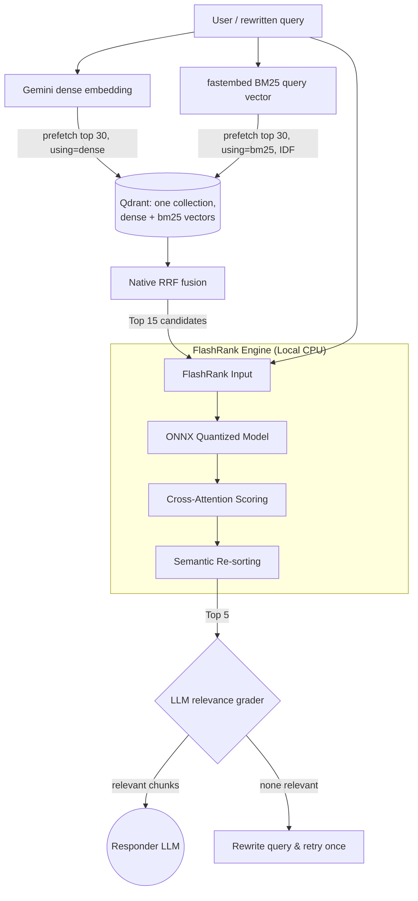

# ⚡ Hybrid Retrieval and FlashRank Reranking

This document explains the mechanism behind **FlashRank**, the semantic reranking engine used in our Retriever node to ensure high-fidelity responses without the cost of cloud-based ranking APIs.

---

## 🔬 The Core Technology: Bi-Encoder vs. Cross-Encoder

In modern RAG systems, there are two main ways to compare a user query with documents:

### 1. The Bi-Encoder (Stage 1a: Qdrant dense search)
*   **Mechanism**: The query and the documents are converted into vectors independently. We then calculate the distance (Cosine Similarity) between them.
*   **Pros**: Extremely fast. You can compare 1 query against millions of documents in milliseconds.
*   **Cons**: It is "semantically fuzzy." It doesn't understand the complex relationship between the query and the text (e.g., it might struggle with negation or technical nuances).

### 1b. Sparse BM25 keyword search (Stage 1b: Qdrant sparse search)
*   **Mechanism**: Each chunk also stores a BM25 sparse vector (fastembed `Qdrant/bm25`); Qdrant applies IDF at query time. Query terms that appear in a chunk score it, rare terms count more.
*   **Pros**: Exact-term matching: `backoffLimit`, `parallelism`, `kubectl get hpa`, `--dry-run`, file names, error codes. Dense vectors tend to blur these into "something about Jobs".
*   **Cons**: No semantics: "retry limit" doesn't find `backoffLimit`.

### Fusion (Stage 1c: Reciprocal Rank Fusion inside Qdrant)
With `RETRIEVAL_MODE=hybrid` (default) one `query_points` call prefetches the dense top 30 and the BM25 top 30 and fuses them with Qdrant's native RRF (`FusionQuery(fusion=Fusion.RRF)`). RRF only uses ranks, `score(d) = Σ_i 1 / (k + rank_i(d))` (Qdrant's default k is 2; the textbook value is 60), so the incomparable cosine and BM25 scales never need to be normalised. A chunk ranked high by *both* searches rises to the top. The fused top 15 go to FlashRank. With `RETRIEVAL_MODE=dense`, stage 1 is the dense search alone.

### 2. The Cross-Encoder (Stage 2: FlashRank)
*   **Mechanism**: The query and a document are fed into the model **together** as a single pair. The model looks at them simultaneously to calculate a relevance score.
*   **Pros**: Highly accurate. It understands deep context, intent, and nuance.
*   **Cons**: Computationally expensive and slow.

**Our Solution**: We use a **Two-Stage Pipeline**. Stage 1 (hybrid dense + BM25 with RRF, or dense only) quickly finds the top 15 candidates, and then the Cross-Encoder (FlashRank) precisely re-scores only those 15. The relevance grader then judges the top 5.

---

## 🔄 FlashRank Mechanism Flow

### Why rerank after fusion?
RRF decides *which* candidates make the pool, but its order is only a vote between two rankers that each looked at the query and the chunk **separately**. A chunk can win RRF because it repeats the query terms (BM25) and sits in the right topic (dense) without answering the question. The cross-encoder reads query and chunk **together**, so it judges whether the chunk actually answers. Fusion improves recall (the right chunk is in the 15), and reranking improves precision at the top 5 that the grader and the LLM see.

### Scores in citations
`retrieval_score` is the stage-1 score: cosine similarity in dense mode, the RRF fusion score in hybrid mode (rank-based, at most 1.0 for a chunk ranked first by both searches; it is not a similarity). `rerank_score` is FlashRank's score. Each record also carries `retrieval_mode`, and the plan step shows it, for example `Retrieval attempt 1/2 (hybrid): 5 chunks retrieved for '…'`.

---

## 🛠️ Implementation Details

### The Model
We use FlashRank's default model, `ms-marco-TinyBERT-L-2-v2` (`Ranker()` is created without a `model_name`; the Dockerfile pre-downloads this model).
*   **Format**: a small cross-encoder exported to **ONNX**, so it runs on CPU without a GPU or PyTorch.
*   **Performance**: not measured in this repository yet. `python -m evals.retrieval_benchmark` reports the average latency with and without FlashRank.

### Lazy Initialization
To keep imports and API startup cheap, the model is loaded **lazily** by `_get_ranker()`:
1.  The API starts without loading the model.
2.  The first time a user sends a query, the model is loaded into memory.
3.  Subsequent queries use the warm model for near-instant results.

### Fault Tolerance
If the FlashRank engine fails (e.g., out of memory or model corruption), the system is designed to **automatically fall back** to the stage-1 order (the RRF-fused order in hybrid mode). This ensures that the user always gets an answer, even if the reranking step is skipped.

If **Qdrant or the embedding service** fails, retrieval raises `RetrievalError` instead of returning an empty list. The agent ends the request with "Knowledge base unavailable." (no query rewrite, no "not in the documents" answer), `/query` still returns its normal response shape, and the MCP `search_knowledge_base` tool returns a friendly "temporarily unavailable" error.

---

## 🏛️ Architectural Decision: Custom Implementation vs. LangChain Native

LangChain provides a native `FlashrankRerank` document compressor that can be used inside a `ContextualCompressionRetriever`. While using this wrapper would slightly reduce our lines of code, we explicitly chose a **custom implementation** (`app/services/retrieval/ranking_service.py`) for enterprise production readiness:

1.  **Granular Observability (Logfire)**: LangChain's wrapper abstracts the reranking process into a "black box." Our custom implementation allows us to inject precise `logfire.span()` tracking directly around the Cross-Encoder execution, logging the exact millisecond latency and top semantic scores.
2.  **Startup Performance (Lazy Loading)**: The native LangChain wrapper initializes the heavy ONNX model upon instantiation. This would severely delay the FastAPI server boot time and potentially cause "Logfire poisoning" if imported too early. Our `_get_ranker()` function loads the model *lazily*, ensuring instant server startup.
3.  **Fallback Logic**: Our code catches reranker errors and falls back to the stage-1 (Qdrant) order, so a reranker failure degrades ranking quality instead of failing the request.
4.  **Decoupled State Management**: LangChain's retrievers work with `Document` objects. Our LangGraph state keeps evidence as plain dicts (`content`, `source`, `source_type`, `score`, `retrieval_mode`, plus `rerank_score` after reranking), and `rerank_records()` reorders those dicts directly, so source metadata survives into citations.

---

## 📈 Why a local reranker
1.  **No per-query cost**: it runs on the API's CPU, with no reranking API.
2.  **Privacy**: chunks are not sent to a third party for the ranking step (they still go to the LLM for grading and answering).
3.  **Precision at the top**: the grader and the LLM see the 5 chunks the cross-encoder ranks highest, not just the 5 closest vectors. Whether this improves this corpus is what the benchmark below measures.

---

## 📏 Measuring it
`python -m evals.retrieval_benchmark` compares dense, dense + FlashRank, hybrid (RRF) and hybrid + FlashRank on the 15 golden questions (hit rate@5, MRR@5, noise rate@5, latency). The benchmark has not been run yet; running it writes the results to `evals/results/retrieval_benchmark.md` (the folder is created on first run).
