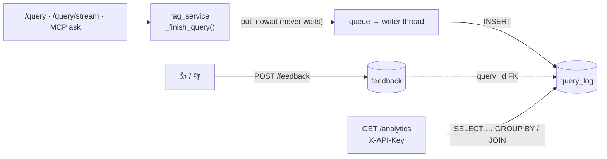

# 📊 Query Analytics & Answer Feedback (hand-written SQL)

Every answered question is logged as one row in `query_log`, and every 👍 / 👎 as one row in `feedback`. `GET /analytics` turns those tables into a report with plain SQL: `GROUP BY`, `HAVING`, `LEFT JOIN`, `CASE`, aggregates and bind parameters. No ORM.



| Piece | File |
|---|---|
| Settings (`ANALYTICS_*`) | `app/analytics/config.py` |
| Engine + migration runner | `app/analytics/db.py` |
| Migrations | `app/analytics/migrations/001_create_query_log.sql`, `002_create_feedback.sql` |
| Logging (background writer) + feedback upsert | `app/analytics/store.py` |
| The analytics queries | `app/analytics/queries.py` |
| Endpoints | `POST /feedback`, `GET /analytics` in `app/main.py` |
| UI | 👍/👎 in `ui/app.py`, the **Analytics** page `ui/pages/analytics.py` |

**SQLAlchemy is only the connection layer.** Every statement is a SQL string run with `sqlalchemy.text()` and named bind parameters (`:since`, `:query_id`). SQLAlchemy supplies the connection pool and hides the driver difference (Python's `sqlite3` locally, psycopg 3 on Postgres), so **the same SQL runs on SQLite and PostgreSQL**.

---

## 1. Configuration and privacy

| Variable | Default | Effect |
|---|---|---|
| `ANALYTICS_ENABLED` | `true` | `false`: nothing is logged, `query_id` is `null`, `/feedback` returns 503 |
| `ANALYTICS_DATABASE_URL` | SQLite file `<project root>/state/analytics.sqlite` | Any SQLAlchemy URL. `postgresql://…` / `postgres://…` are used with psycopg 3. On Cloud Run: Postgres (DOCS/12 §8.6) |
| `ANALYTICS_STORE_QUESTIONS` | `true` | `false` stores `NULL` instead of the question; the top-questions report is then empty |
| `ANALYTICS_API_KEY` | unset | Key for `GET /analytics` (`X-API-Key` header). **Unset → 404**: the endpoint is never open by default |

**What is stored:** a random UUID, the time, `thread_id`, the entry point, the question (unless disabled), the derived intent, retrieval attempts, the verifier verdict, the status text, latency and the number of sources.

**What is never stored:** the answer, the retrieved document text, citations, API keys, client IP addresses.

`state/` is git-ignored and docker-ignored, so a local database is never committed or copied into an image.

---

## 2. Schema

Applied by plain SQL migration files at startup (section 3). These are the statements from the migration files, without their comments:

```sql
CREATE TABLE IF NOT EXISTS query_log (
    id                 TEXT PRIMARY KEY,
    created_at         TEXT NOT NULL,
    thread_id          TEXT,
    source             TEXT NOT NULL CHECK (source IN ('api', 'stream', 'mcp')),
    question           TEXT,
    intent             TEXT NOT NULL CHECK (intent IN ('technical', 'conversational', 'blocked', 'error')),
    retrieval_attempts INTEGER NOT NULL DEFAULT 0 CHECK (retrieval_attempts >= 0),
    grounded           BOOLEAN,
    status             TEXT,
    latency_ms         INTEGER NOT NULL CHECK (latency_ms >= 0),
    source_count       INTEGER NOT NULL DEFAULT 0 CHECK (source_count >= 0)
);
CREATE INDEX IF NOT EXISTS idx_query_log_created_at ON query_log (created_at);

CREATE TABLE IF NOT EXISTS feedback (
    id         TEXT PRIMARY KEY,
    query_id   TEXT NOT NULL UNIQUE REFERENCES query_log (id) ON DELETE CASCADE,
    rating     INTEGER NOT NULL CHECK (rating IN (-1, 1)),
    comment    TEXT CHECK (comment IS NULL OR LENGTH(comment) <= 1000),
    created_at TEXT NOT NULL,
    updated_at TEXT NOT NULL
);
CREATE INDEX IF NOT EXISTS idx_feedback_query_id ON feedback (query_id);

-- created by the migration runner itself
CREATE TABLE IF NOT EXISTS schema_migrations (
    version    TEXT PRIMARY KEY,
    applied_at TEXT NOT NULL
);
```

| Column | Meaning |
|---|---|
| `source` | `api` = `POST /query`, `stream` = `POST /query/stream`, `mcp` = MCP `ask_knowledge_base` |
| `intent` | `technical` (planner chose retrieval), `conversational` (answered from memory), `blocked` (guardrails), `error` (pipeline failure) |
| `retrieval_attempts` | 0 without retrieval; 1 normally; 2 when the grader found nothing relevant and the query was rewritten |
| `grounded` | verifier verdict: true / false / NULL (not verified) |
| `latency_ms` | from the start of the request to the finished answer, measured in `rag_service` |

**Why `created_at` is TEXT.** It is written in a fixed-width UTC format, `YYYY-MM-DD HH:MM:SS.ffffff`. That one representation works on both databases:
- **String order is time order,** so `created_at >= :since` is a correct time filter.
- **`SUBSTR(created_at, 1, 10)` is the calendar day** on SQLite and on Postgres.

SQLite has no date type, and the two databases share no date-truncation function (SQLite: `date()`, Postgres: `DATE_TRUNC` / `::date`), so a native timestamp column would need different SQL per database. A Postgres-only design would use `TIMESTAMPTZ`.

**Booleans:** `BOOLEAN` is a real type in Postgres. In SQLite it is stored as 0/1, and `TRUE`/`FALSE` are 1/0, so `grounded = TRUE` works in both.

---

## 3. Migrations

`app/analytics/migrations/NNN_name.sql` files are applied **in file-name order** by `apply_migrations()` (`app/analytics/db.py`) at API startup, or on first use in the MCP server:

1. `CREATE TABLE IF NOT EXISTS schema_migrations …`
2. `SELECT version FROM schema_migrations` → the set already applied
3. For each newer file, in one transaction: run its statements, then `INSERT INTO schema_migrations (version, applied_at) VALUES (:version, :applied_at) ON CONFLICT (version) DO NOTHING`

**Idempotent:** a second startup applies nothing. Because the DDL uses `IF NOT EXISTS` and the version insert uses `ON CONFLICT DO NOTHING`, two Cloud Run instances starting at the same moment can't break each other.

**Adding a change:** create `003_<what>.sql`. Never edit an applied file; the next startup applies only the new one.

---

## 4. Logging: never in the user's way

`rag_service.answer_question()` (`api`, `mcp`) and `stream_answer()` (`stream`) call `_finish_query()` once per request, for answered, blocked and failed requests alike. It:

1. adds `query_id` to the response: the `/query` JSON, the SSE `done` event and the MCP `ask_knowledge_base` result;
2. builds the row and **puts it on a bounded in-memory queue with `put_nowait`**, which never waits;
3. leaves the `INSERT` to a single background thread.

Because of that:
- **The request thread never connects to the database.** A slow or dead database adds no latency; a test proves the answer returns in under 0.5 s while the database "takes" 1 s.
- **Failures are contained.** A full queue (1,000 rows) or a database error drops the row with a logged warning; the user still gets the answer.
- **Outages are cheap.** While the database is unreachable, the writer pauses for 60 s instead of retrying on every request.
- **Shutdown drains the queue.** The API's shutdown writes what's queued, waiting up to 2 s.
- **Known gap:** a stream whose client disconnects before the end isn't logged.

`intent` comes from what the pipeline already reports (`thought_process` and `status`):

| Result | intent |
|---|---|
| `status == "error"` | `error` |
| `Intent: Guardrails Fired` | `blocked` |
| `Intent: Conversational/Memory` | `conversational` |
| `Intent: Technical` / a retrieval step | `technical` |

---

## 5. Endpoints

### `POST /feedback`

```bash
curl -X POST localhost:8000/feedback -H 'Content-Type: application/json' \
  -d '{"query_id": "6f0c…", "rating": 1, "comment": "Clear answer"}'
```

| Case | Response |
|---|---|
| New vote | **201** with `{query_id, rating, comment, created_at, updated_at}` |
| Second vote on the same answer | **201**, the row is updated (one row per query) |
| Unknown `query_id` | **404** |
| `rating` not 1 / -1, `comment` over 1,000 characters | **422** |
| Analytics disabled or database down | **503** |
| Too many votes | **429** (same limit as `/query`, own budget) |

The write is one portable upsert. `ON CONFLICT … DO UPDATE` exists in SQLite ≥ 3.24 and PostgreSQL ≥ 9.5:

```sql
INSERT INTO feedback (id, query_id, rating, comment, created_at, updated_at)
VALUES (:id, :query_id, :rating, :comment, :now, :now)
ON CONFLICT (query_id) DO UPDATE SET
    rating = excluded.rating,
    comment = excluded.comment,
    updated_at = excluded.updated_at
```

`excluded` is the row that failed to insert. `created_at` isn't in the `SET` list, so it keeps the first vote's time.

### `GET /analytics?days=7`

```bash
curl -H "X-API-Key: $ANALYTICS_API_KEY" "localhost:8000/analytics?days=7"
```

| Case | Response |
|---|---|
| `ANALYTICS_API_KEY` not configured | **404** (the endpoint doesn't exist) |
| Missing or wrong `X-API-Key` | **401**. The key is compared with `hmac.compare_digest`, which takes the same time wherever the strings differ |
| `days` outside 1–90 | **422** |
| OK | **200**, the JSON below |

The window is midnight UTC `days - 1` days ago until now, so `days=7` means today plus the 6 full days before it.

---

## 6. The analytics queries

All of them are in `app/analytics/queries.py`, each in its own function, with `:since` = the window start.

**Example data.** The results below are real output of these functions, run on the dataset seeded by `tests/test_analytics.py` (which asserts the same numbers) with "now" = 2026-11-07 12:00 UTC and `days=7`:

| id | created_at | source | question | intent | attempts | grounded | latency_ms | feedback |
|---|---|---|---|---|---:|---|---:|---|
| q1 | 2026-11-01 09:00 | api | What is a Job? | technical | 1 | true | 1000 | 👍 |
| q2 | 2026-11-01 10:00 | api | `what is a job? ` | technical | 2 | false | 3000 | 👎 |
| q3 | 2026-11-03 08:00 | stream | What is a Job? | technical | 1 | NULL | 2000 | |
| q4 | 2026-11-03 09:00 | stream | hello | conversational | 0 | NULL | 500 | 👍 |
| q5 | 2026-11-05 11:00 | mcp | tell me a joke | blocked | 0 | NULL | 100 | |
| q6 | 2026-11-07 11:59 | mcp | hello | conversational | 0 | NULL | 300 | |
| q7 | 2026-11-07 06:00 | api | Explain HPA | error | 0 | NULL | 50 | |
| old | 2026-10-31 23:59 | api | What is a Job? | technical | 2 | true | 9000 | 👍 (outside the window) |

### a) Queries per day

```sql
SELECT SUBSTR(created_at, 1, 10) AS day,
       COUNT(*)                  AS queries
FROM query_log
WHERE created_at >= :since
GROUP BY SUBSTR(created_at, 1, 10)
ORDER BY day
```
```json
[{"day": "2026-11-01", "queries": 2}, {"day": "2026-11-03", "queries": 2}, {"day": "2026-11-05", "queries": 1}, {"day": "2026-11-07", "queries": 2}]
```
Days without queries are simply absent (the UI chart shows the days present).

### b) Intent breakdown

```sql
SELECT intent,
       COUNT(*) AS queries
FROM query_log
WHERE created_at >= :since
GROUP BY intent
ORDER BY queries DESC, intent
```
```json
[{"intent": "technical", "queries": 3}, {"intent": "conversational", "queries": 2}, {"intent": "blocked", "queries": 1}, {"intent": "error", "queries": 1}]
```

### c) Grounded rate of technical answers

```sql
SELECT COUNT(*)                                             AS technical_answers,
       COUNT(grounded)                                      AS verified_answers,
       SUM(CASE WHEN grounded = TRUE THEN 1 ELSE 0 END)     AS grounded_answers,
       AVG(CASE WHEN grounded = TRUE  THEN 1.0
                WHEN grounded = FALSE THEN 0.0 END)          AS grounded_rate
FROM query_log
WHERE created_at >= :since
  AND intent = 'technical'
```
```json
{"technical_answers": 3, "verified_answers": 2, "grounded_answers": 1, "grounded_rate": 0.5}
```
The `CASE` has no `ELSE`, so unverified answers become NULL. `AVG` skips NULLs, so the rate is grounded ÷ verified (1 of 2), not grounded ÷ all (1 of 3). `COUNT(grounded)` also skips NULLs, while `COUNT(*)` counts rows.

### d) Retrieval attempts and rewrites

```sql
SELECT COUNT(*)                                                AS technical_questions,
       AVG(retrieval_attempts * 1.0)                           AS avg_retrieval_attempts,
       SUM(CASE WHEN retrieval_attempts > 1 THEN 1 ELSE 0 END) AS rewritten_questions,
       AVG(CASE WHEN retrieval_attempts > 1 THEN 1.0 ELSE 0.0 END) AS rewrite_rate
FROM query_log
WHERE created_at >= :since
  AND intent = 'technical'
```
```json
{"technical_questions": 3, "avg_retrieval_attempts": 1.3333, "rewritten_questions": 1, "rewrite_rate": 0.3333}
```
`AVG` of a 1/0 `CASE` is the share of rows where the condition holds.

### e) Feedback summary (LEFT JOIN)

```sql
SELECT COUNT(*)                                          AS answers,
       COUNT(f.id)                                       AS answers_with_feedback,
       SUM(CASE WHEN f.rating = 1  THEN 1 ELSE 0 END)    AS thumbs_up,
       SUM(CASE WHEN f.rating = -1 THEN 1 ELSE 0 END)    AS thumbs_down,
       AVG(CASE WHEN f.rating = 1  THEN 1.0
                WHEN f.rating = -1 THEN 0.0 END)         AS satisfaction_rate,
       COUNT(f.id) * 1.0 / NULLIF(COUNT(*), 0)           AS feedback_rate
FROM query_log AS q
LEFT JOIN feedback AS f
       ON f.query_id = q.id
WHERE q.created_at >= :since
```
```json
{"answers": 7, "answers_with_feedback": 3, "thumbs_up": 2, "thumbs_down": 1, "satisfaction_rate": 0.6667, "feedback_rate": 0.4286}
```
- **`LEFT JOIN`** keeps all 7 queries; the 4 without a vote get NULL feedback columns. An `INNER JOIN` would keep only the 3 voted queries, and the feedback rate would always be 100%.
- **The window applies to query time.** The vote on `old` isn't counted, because its query is outside the window.
- **`NULLIF(COUNT(*), 0)` avoids division by zero.** On an empty window, SQLite would return NULL for `x / 0` while Postgres would raise an error; with `NULLIF` both return NULL.

### f) Most frequent questions

```sql
SELECT LOWER(TRIM(question)) AS normalized_question,
       COUNT(*)              AS times_asked
FROM query_log
WHERE created_at >= :since
  AND question IS NOT NULL
GROUP BY LOWER(TRIM(question))
HAVING COUNT(*) >= :min_count
ORDER BY times_asked DESC, normalized_question
LIMIT :limit
```
```json
[{"question": "what is a job?", "times_asked": 3}, {"question": "hello", "times_asked": 2}]
```
- `"What is a Job?"` and `"what is a job? "` count as one question.
- `HAVING` (with `:min_count` = 2) drops questions asked once.
- It runs only when `ANALYTICS_STORE_QUESTIONS=true`.
- SQLite's `LOWER` folds ASCII letters only.

### g) Latency per entry point

```sql
SELECT source,
       COUNT(*)        AS queries,
       AVG(latency_ms) AS avg_latency_ms,
       MAX(latency_ms) AS max_latency_ms
FROM query_log
WHERE created_at >= :since
GROUP BY source
ORDER BY source
```
```json
[{"source": "api", "queries": 3, "avg_latency_ms": 1350.0, "max_latency_ms": 3000, "p95_latency_ms": 3000.0},
 {"source": "mcp", "queries": 2, "avg_latency_ms": 200.0, "max_latency_ms": 300, "p95_latency_ms": 300.0},
 {"source": "stream", "queries": 2, "avg_latency_ms": 1250.0, "max_latency_ms": 2000, "p95_latency_ms": 2000.0}]
```
**p95 is computed in Python.** The percentile SQL differs between the two databases: Postgres has `PERCENTILE_CONT(0.95) WITHIN GROUP (ORDER BY latency_ms)`, and SQLite has no percentile function. So a second query (`SELECT source, latency_ms … ORDER BY source, latency_ms`) fetches the values, and `percentile()` takes the nearest rank: with n values, the ⌈0.95·n⌉-th smallest.

`GET /analytics` returns all of these together, plus `days`, `since`, `total_queries` and `questions_stored`.

---

## 7. Querying the SQLite file directly

```bash
sqlite3 state/analytics.sqlite ".tables"
# feedback           query_log          schema_migrations

sqlite3 state/analytics.sqlite ".schema feedback"

sqlite3 -header -column state/analytics.sqlite \
  "SELECT intent, COUNT(*) AS queries FROM query_log GROUP BY intent ORDER BY queries DESC;"
# intent          queries
# --------------  -------
# technical       4
# conversational  2
# error           1
# blocked         1

sqlite3 -header -column state/analytics.sqlite "SELECT * FROM schema_migrations;"
```

(The output above is from the example database. `technical` is 4 here because this ad-hoc query has no time window, so the `old` row counts.)

Things to know:
- **Foreign keys are off by default in the `sqlite3` shell.** The app turns them on for every connection; run `PRAGMA foreign_keys = ON;` before writing by hand.
- **The database uses WAL mode,** so you may see `analytics.sqlite-wal` and `-shm` files next to it. They're part of the database; copy all three, or run `PRAGMA wal_checkpoint;` first.
- **Prefer read-only access while the API runs:** `sqlite3 -readonly …`.

---

## 8. SQL concepts used

| Concept | Where | Why |
|---|---|---|
| `GROUP BY` | per day, per intent, per source, per question | One output row per group; aggregates are computed per group |
| Aggregates `COUNT(*)`, `COUNT(col)`, `SUM`, `AVG`, `MAX` | every report | `COUNT(*)` counts rows, `COUNT(col)` skips NULLs, `AVG` skips NULLs |
| `CASE WHEN … THEN … END` | grounded rate, rewrite rate, thumbs up/down | Turns a condition into 1/0 (or NULL) so `SUM` counts and `AVG` gives a share |
| `WHERE` vs `HAVING` | top questions | `WHERE` filters rows **before** grouping (time window, `question IS NOT NULL`); `HAVING` filters groups **after** aggregation (`COUNT(*) >= 2`) |
| `LEFT JOIN` | feedback summary | Keeps every query, with NULLs where there is no feedback; `INNER JOIN` would drop them |
| `NULLIF` | feedback rate | Turns a 0 denominator into NULL: no division-by-zero error on Postgres |
| Indexes | `query_log(created_at)`, `feedback(query_id)` | Range scans for the time window and fast JOIN lookups, at the cost of a little extra work on each INSERT |
| `PRIMARY KEY` | `id` columns | Unique, non-null row identity (random UUIDs: safe to generate on any instance) |
| `FOREIGN KEY … REFERENCES … ON DELETE CASCADE` | `feedback.query_id` | Feedback can't point to a non-existent query; deleting a query deletes its feedback |
| `CHECK` | `rating IN (-1, 1)`, `source`/`intent` values, `LENGTH(comment) <= 1000`, non-negative counts | The database itself rejects invalid data, even if a code path forgets to validate |
| `UNIQUE` + `ON CONFLICT … DO UPDATE` | one feedback per query | A second vote updates the row (an "upsert") instead of creating a duplicate |
| Parameterised queries (`:name`) | every statement | Values travel separately from the SQL text, so input like `'; DROP TABLE query_log; --` is stored as text (tested) and never executed |
| Transactions | each migration, each feedback write | All statements commit together or not at all |
