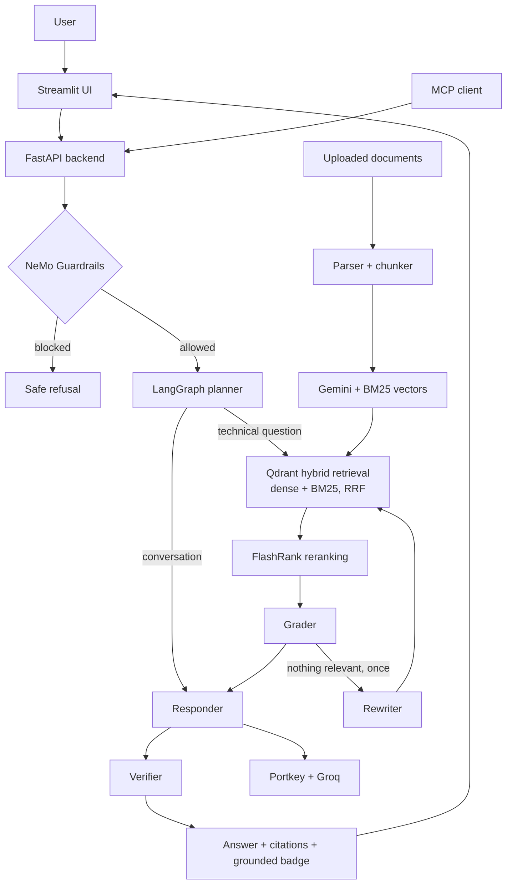

# Enterprise Agentic RAG - Beginner Guide

> **Goal:** Read this document from top to bottom before discussing the project in an interview. It explains what the application does, why each component exists, how the code is organized, and how to answer common questions honestly and clearly.

## 1. Start here: what did we build?

This project is an **AI assistant for private technical documents**. A user uploads or prepares documents such as PDFs, Word files, HTML pages, text files, or PowerPoint slides. The application reads those documents and lets the user ask questions in natural language.

Example:

```text
Document: Kubernetes job-management guide
Question: How do I monitor a Kubernetes Job?
Answer: A concise answer generated from the relevant parts of that guide,
        with the source filename and retrieved evidence shown to the user.
```

The important idea is that the assistant should not answer only from its general training. It first searches the provided documents and then answers using that evidence. This is called **Retrieval-Augmented Generation (RAG)**.

### One-sentence interview answer

> “Enterprise Agentic RAG is a FastAPI service with a Streamlit UI and an MCP server. It indexes technical documents in Qdrant with both Gemini embeddings and BM25 keywords, and a LangGraph agent retrieves, reranks and grades the evidence, retries once with a rewritten query if nothing is relevant, answers with inline citations, and then checks the answer against the sources. Guardrails run before everything, answers stream token by token, and conversations are remembered per thread.”

### The problem it solves

Normal document search returns links or matching keywords. A normal LLM can give fluent answers but may invent information. This project combines the two:

1. Search the organisation's trusted documents.
2. Select the best passages.
3. Give those passages to an LLM with clear instructions.
4. Show the supporting source to the user.

This is useful for internal IT knowledge bases, policy assistants, product-support documentation, engineering runbooks, and similar private-document use cases.

---

## 2. The most important words, in plain English

| Term | Simple meaning | Why it matters here |
|---|---|---|
| **LLM** | A Large Language Model such as a Groq-hosted model. It writes natural-language answers. | It turns retrieved evidence into a readable answer. |
| **RAG** | Retrieval-Augmented Generation. Search documents first, then generate an answer. | Reduces unsupported answers and lets the system use private data. |
| **Embedding** | A long list of numbers representing the meaning of text. | Lets the system search by meaning, not only exact words. |
| **BM25** | A classic keyword-scoring formula: rare words that appear in a chunk count more. | Finds exact technical terms such as `backoffLimit` that embeddings blur. |
| **Hybrid search / RRF** | Running meaning search and keyword search together, then merging the two rankings with Reciprocal Rank Fusion. | Gets the strengths of both searches without comparing their incompatible scores. |
| **Vector database** | A database optimized for searching embeddings. | Qdrant stores document chunks and finds similar chunks quickly. |
| **Chunk** | A small piece of a larger document. | The system searches manageable passages instead of an entire PDF. |
| **Reranking** | A second, more precise ordering of search results. | FlashRank moves the strongest evidence to the top. |
| **API** | A structured way for software systems to communicate. | Streamlit calls the FastAPI backend; the backend calls AI services. |
| **FastAPI** | A Python framework for building web APIs. | It exposes `/query`, `/query/stream`, `/documents`, `/threads/{id}/reset` and `/health`. |
| **Streamlit** | A Python framework for building data/AI web interfaces quickly. | It provides the visible chat and upload experience. |
| **LangChain** | A library that helps connect LLMs, prompts, retrievers, and tools. | It supplies integrations used by the system. |
| **LangGraph** | A library for modeling LLM workflows as a graph of steps and decisions. | It controls the planner → retriever → grader → (rewriter) → responder → verifier flow and conversation memory. |
| **Checkpointer** | LangGraph's storage for the graph state, saved after every step and keyed by `thread_id`. | Gives conversation memory that survives restarts (SQLite locally, Postgres on Cloud Run). |
| **SSE** | Server-Sent Events: a normal HTTP response the server keeps writing small events to. | Streams plan steps and answer tokens to the UI as they happen. |
| **MCP** | Model Context Protocol: a standard way for AI assistants to call external tools. | Lets Claude Desktop or Claude Code query this knowledge base. |
| **Guardrails** | Rules and checks around an LLM. | They block jailbreaks and off-topic requests before retrieval. |
| **Observability** | Traces, logs, and metrics that show what the system did. | Logfire and LangSmith make failures and decisions visible. |

---

## 3. Python and web-development basics you need

You do not need to memorize every line of Python. You need to understand the role of the common building blocks.

### Python modules and imports

A Python file is a **module**. `import` lets one module use code from another module.

```python
from app.services.retrieval.qdrant_service import search_enterprise_knowledge
```

This means: “Use the `search_enterprise_knowledge` function defined in the Qdrant service file.” It keeps the application organized rather than putting all code in one large file.

### Functions

A function is a reusable unit of work.

```python
def health_check():
    return {"status": "ok"}
```

The function runs when a client requests the health endpoint. Functions make code easier to test and reason about.

### Classes and models

Classes group data and behavior. This project uses Pydantic models to validate API data.

```python
class QueryRequest(BaseModel):
    q: str
    thread_id: str
```

This means an incoming query should contain text (`q`) and a conversation ID (`thread_id`). Validation prevents malformed input from silently reaching the AI workflow.

### JSON

APIs commonly send **JSON**, a text format for structured data.

```json
{
  "q": "How do I monitor a Kubernetes Job?",
  "thread_id": "demo-session"
}
```

The backend returns JSON with the answer, status, reasoning steps, and sources.

### Environment variables

Environment variables are secret or deployment-specific values kept outside source code.

```text
GEMINI_API_KEY=...
QDRANT_API_KEY=...
```

Never hardcode these keys in Python files or commit them to GitHub. The project reads them through `os.getenv()` in `app/config.py`.

---

## 4. Why are there so many APIs and keys?

One product can use several specialized services. Each service does a different job better than a single general-purpose API could.

| Variable / service | What it is used for | Why it exists |
|---|---|---|
| `GEMINI_API_KEY` | Google Gemini embedding model | Converts document chunks and questions into vectors for semantic search. |
| `QDRANT_API_KEY` and `QDRANT_CLUSTER_ENDPOINT` | Qdrant Cloud | Stores vectors and performs fast similarity search. |
| `GROQ_API_KEY` | Groq model access | Runs the NeMo guardrail classifier directly (`llama-3.1-8b-instant`). |
| `GROQ_FALLBACK_API_KEY` | Secondary Groq credential | Not used by the code. The agent's two Groq keys are stored inside Portkey (integrations `rag` and `brag`), which handles the fallback. |
| `PORTKEY_API_KEY` | Portkey LLM gateway | Every agent LLM call goes through it: routing to Groq, retries, fallback model, cache, request metadata. |
| `DATABASE_URL` | Postgres (optional) | Shared conversation memory on Cloud Run (`CHECKPOINTER=postgres`). |
| `LOGFIRE_TOKEN` | Pydantic Logfire | Records logs and spans for debugging and observability. |
| `LANGSMITH_API_KEY` | LangSmith | Captures LangChain/LangGraph traces and helps inspect agent behavior. |
| `JUDGE_GROQ` | Evaluation-only model key | Scores RAG evaluation metrics without using the live app's key. |

### Why not use only one LLM API?

Because the tasks are different:

- Embeddings need a model optimized for semantic representation, not conversational text.
- A vector database needs optimized nearest-neighbor search.
- The answer model needs strong natural-language generation.
- An LLM gateway handles reliability and observability across model providers.
- Monitoring tools should be independent so developers can diagnose behavior.

### Correct security answer in an interview

> “The browser never receives the provider keys. The Streamlit UI talks to the backend, and on Cloud Run the backend reads its keys from Google Secret Manager; the deploy pipeline authenticates with Workload Identity Federation, so no long-lived cloud key exists anywhere. Locally, keys live in `.env`, which is in `.gitignore` and `.dockerignore`.”

---

## 5. High-level architecture



### Read the architecture from left to right

1. The user asks a question in Streamlit.
2. Streamlit calls FastAPI's `/query/stream` endpoint (or `/query` as a fallback). MCP clients reach the same logic through the MCP server.
3. Guardrails inspect the question before document search or answer generation.
4. The planner decides whether the question needs documents.
5. Technical questions retrieve evidence from Qdrant (meaning + keyword search), rerank it, and grade it for relevance. If nothing is relevant, the query is rewritten and the search runs once more.
6. The responder writes an answer with `[n]` citations, using the evidence and conversation history. If no relevant evidence was found, it says so instead.
7. The verifier checks the answer against the evidence.
8. The UI shows live steps, the streamed answer, the sources and the grounded badge.

---

## 6. File-by-file map of the repository

| Location | Responsibility | Interview explanation |
|---|---|---|
| `app/main.py` | FastAPI entrypoint, endpoints and lifespan | “This is the backend boundary. It validates requests, applies rate limits, streams SSE and opens/closes the checkpointer.” |
| `app/services/rag_service.py` | Shared guardrails → agent logic | “The API and the MCP server both call this, so they can't drift apart.” |
| `app/rate_limit.py` | Per-IP rate limiting | “Protects the LLM budget from a single client.” |
| `app/mcp_server.py` | MCP server | “Exposes ask, search and list tools to AI assistants.” |
| `app/config.py` | Environment-variable configuration | “This keeps secrets and deployment configuration outside source code.” |
| `app/agents/graph.py` | LangGraph workflow | “This defines which agent node runs next.” |
| `app/agents/state.py` | Shared workflow state | “It describes the data passed between the nodes and resets per-request fields.” |
| `app/agents/routing.py` | Pure routing rules and LLM-output parsers | “Every branch decision is a plain function, unit-tested without an LLM.” |
| `app/agents/checkpointer.py` | Conversation-memory backend | “Chooses memory, SQLite or Postgres from one setting.” |
| `app/agents/nodes/planner.py` | Intent classification and query refinement | “It decides conversational versus retrieval-based handling.” |
| `app/agents/nodes/retriever.py` | Search and reranking | “It turns a query into evidence records.” |
| `app/agents/nodes/grader.py`, `rewriter.py`, `verifier.py` | Corrective RAG and Self-RAG | “They drop irrelevant chunks, retry with a better query, and check the answer.” |
| `app/agents/nodes/responder.py` | Final answer generation | “It constructs a citation-numbered prompt from context and history, and streams tokens on `/query/stream`.” |
| `app/ingestion/loaders/` | PDF, HTML, TXT, DOCX, PPTX parsing | “Each format has a suitable local parser.” |
| `app/ingestion/chunking/` | Splits text into chunks: `paragraph` (default), `fixed`, `recursive`, `semantic` | “Chunking is configurable, and `evals/chunking_experiment.py` measures which strategy retrieves best.” |
| `app/ingestion/processor.py` | Parse -> chunk -> embed -> index | “This is the ingestion pipeline.” |
| `app/services/retrieval/embedding.py` | Gemini embedding client | “Creates semantic vectors for text.” |
| `app/services/retrieval/qdrant_service.py` | Qdrant schema and search | “Runs hybrid (dense + BM25, RRF) or dense search.” |
| `app/services/retrieval/sparse_embedding.py` | BM25 sparse vectors | “Keyword weights for exact technical terms.” |
| `app/services/retrieval/ranking_service.py` | FlashRank reranker | “Improves the ordering of initial search results.” |
| `app/services/retrieval/citations.py` | Context formatting and citation records | “Preserves source provenance into the final UI/API response.” |
| `app/guardrails/` | NeMo Guardrails rules | “Rejects unsafe or unrelated requests early.” |
| `app/gateway/client.py` | Portkey and model routing | “Encapsulates retries, fallback, metadata, and model access.” |
| `ui/app.py` | Streamlit application | “The browser-facing experience, upload flow, chat, and source display.” |
| `evals/` | Golden data, pipeline, and RAGAS metrics | “Measures quality instead of relying on subjective demos.” |
| `tests/` | Unit and API tests | “About 360 tests: routing, graph shape with fake nodes, SSE events, memory, rate limits. No keys or network needed.” |
| `Dockerfile` | Backend container definition | “Makes backend runtime repeatable in deployment.” |
| `.github/workflows/` | CI and Cloud Run deploy | “Every push runs lint, tests with a coverage gate, and a Docker smoke test.” |

---

## 7. Ingestion: from file to searchable knowledge

### Step 1: upload or provide a document

The UI supports PDF, HTML, TXT, DOCX, and PPTX. The backend validates:

- file extension;
- empty file content;
- a 25 MB size limit per uploaded file.

This validation protects the service from unsupported formats and unusually large uploads.

### Step 2: parse the file

Different formats need different parsers:

| Format | Parser approach |
|---|---|
| PDF | `pypdf`, with `pdfplumber` for pages pypdf returns blank (no OCR) |
| HTML | BeautifulSoup parsing |
| TXT | Direct text reading |
| DOCX | `python-docx` (paragraphs and tables) |
| PPTX | `python-pptx` |

The result is plain text.

### Step 3: split text into chunks

Sending an entire document to an LLM is slow, expensive, and often impossible because models have context limits. The chunker divides the document into smaller passages, using paragraphs where possible.

The current chunker has a maximum-size boundary. This is important: a very long paragraph must not create an oversized chunk.

### Step 4: create embeddings

Each chunk gets **two** vectors:

- a **dense** vector from Gemini (`gemini-embedding-2-preview`, 3072 numbers), where similar meanings produce vectors that are close together;
- a **sparse BM25** vector from fastembed, which records which words appear and how important they are. It runs locally on the CPU.

Example idea:

```text
“How do I scale pods?”
“Horizontal Pod Autoscaler increases replica count.”
```

These sentences use different words but have related meaning, so vector search can connect them.

### Step 5: index in Qdrant

The project stores:

- the `dense` and `bm25` vectors (one Qdrant point per chunk);
- chunk text;
- original filename;
- source type, such as `true`, `noisy`, or `uploaded`.

The collection name comes from `QDRANT_COLLECTION` (code default `enterprise_rag`; Cloud Run is deployed with `enterprise_rag_v2`, the name used for the hybrid schema). If the collection doesn't exist, ingestion or the first upload creates it. If it exists with the old single-vector schema, the app refuses to mix formats and asks you to re-ingest with `--wipe`.

### Strong interview answer

> “The ingestion pipeline is modular. A loader extracts text, the chunker makes bounded passages, and each chunk is stored in Qdrant with a Gemini meaning vector, a BM25 keyword vector, and its filename and source type. Keeping metadata is important because it lets the UI show the evidence behind an answer.”

---

## 8. Retrieval: how the system finds relevant information

When the user asks a technical question, the system does not scan every document one by one.

### Hybrid search in Qdrant

1. Convert the question into a Gemini vector **and** a BM25 keyword vector.
2. Qdrant finds the 30 closest chunks by meaning and the 30 best chunks by keywords.
3. Qdrant merges the two lists with **Reciprocal Rank Fusion** (RRF): a chunk ranked high in both lists rises to the top. RRF only looks at positions in each list, so the two incompatible score scales never need to be compared.
4. The top 15 candidates come back with their content, filename and fusion score.

Why both? Meaning search understands "retry limit" ≈ `backoffLimit`, but blurs exact terms. Keyword search finds `backoffLimit` exactly, but doesn't understand synonyms. `RETRIEVAL_MODE=dense` switches the keyword half off.

The project retrieves more candidates than it ultimately uses. This is a common pattern: first-stage search is fast, but not precise.

### Why reranking is needed

The vector database is good at broad semantic matching. However, the top result may be related but not the best answer to the exact question.

FlashRank is a **cross-encoder reranker**. It reads the question and candidate passage together and assigns a more precise relevance score.

```text
Question -> Qdrant hybrid search: 15 candidates -> FlashRank keeps best 5 -> grader keeps the relevant ones -> LLM answers
```

### Grading, retrying and admitting "I don't know"

Reranking always returns *some* top 5, even when none of them answers the question. So a **grader** (one LLM call for all 5 chunks) keeps only the relevant ones. If none are relevant, a **rewriter** writes a different search query and the search runs once more. If that also finds nothing, the answer is a fixed "I couldn't find this in the indexed documents" message, deliberately not written by the LLM so it can't fall back to general knowledge.

### Why retain citations

Earlier RAG implementations often turn results into anonymous strings and lose source information. This project preserves:

- `source` - original filename;
- `source_type` - trusted/uploaded/noisy category;
- `retrieval_score` - first-stage score (RRF fusion score in hybrid mode, cosine similarity in dense mode);
- `rerank_score` - FlashRank relevance.

The answer cites sources inline as `[1]`, `[2]`, and the numbers match the order of the `sources` list. That makes the answer inspectable.

### Important limitation to say honestly

Source attribution improves transparency, but it does not prove every sentence is correct. The verifier node is a second LLM's opinion, not a proof: it can be wrong in both directions. High-risk decisions still need evaluation and human review.

---

## 9. LangChain and LangGraph

### What is LangChain?

LangChain is an integration library. It provides common interfaces for models, embedding providers, document tools, and retrievers. In this project, `ChatOpenAI` is used with Portkey's OpenAI-compatible endpoint, even though the actual model provider is Groq.

### What is LangGraph?

LangGraph is used when an LLM application has multiple steps and decisions. Instead of writing one giant prompt, we define nodes and transitions.

Current graph (node names from `app/agents/graph.py`):

```text
planner
  -> CONVERSATIONAL? -> responder -> End
  -> technical?      -> retriever -> grader
                          grader: relevant chunks          -> responder -> verifier -> End
                          grader: none, first attempt      -> rewriter  -> retriever (again)
                          grader: none, second attempt     -> responder ("not in the documents") -> End
                        retriever: knowledge base down     -> End ("knowledge base unavailable")
```

`ENABLE_SELF_CORRECTION=false` switches back to the original `planner -> retriever -> responder` graph.

### Why a graph instead of a simple function chain?

A simple chain always runs the same sequence. This project needs branching:

- a greeting does not need Qdrant search;
- a technical question does;
- a search that found nothing relevant loops back once through the rewriter, and a graph models a loop with a hard limit naturally (`MAX_RETRIEVAL_ATTEMPTS = 2`).

### What is the state object?

`AgentState` is the shared data passed between nodes. It includes:

- `messages` - previous user/assistant messages;
- `current_query` - original or refined search query;
- `documents` - retrieved evidence records;
- `plan` - visible reasoning/status steps;
- `status` - current outcome;
- `final_answer` - response returned to the API;
- `retrieval_attempts` - how many searches ran (bounds the loop);
- `grounded` - the verifier's verdict (true, false or unknown).

### Conversation memory

A LangGraph **checkpointer** saves the state after every node, keyed by `thread_id`. On the next request with the same `thread_id`, the graph continues from the saved state, so the planner and responder can see earlier messages. Only `messages` carries over; `new_request_state()` resets the per-question fields. The backend is chosen with `CHECKPOINTER`: `sqlite` (default, a local file that survives restarts), `postgres` (for Cloud Run, where the container disk is temporary and not shared between instances) or `memory` (tests). The UI's **Clear History & Memory** button calls `POST /threads/{thread_id}/reset`.

### Strong interview answer

> “I used LangGraph because the flow has branches and a loop. The planner decides whether retrieval is necessary; for technical questions a grader checks the evidence and can send the query back through a rewriter once; a verifier checks the final answer. The routing rules are pure functions I can unit-test, and the checkpointer keyed by thread ID makes conversation memory explicit and persistent rather than hidden in a global variable.”

---

## 10. Prompt engineering in this project

Prompt engineering is not only writing a clever sentence. It is designing instructions and context so the model has the right task, boundaries, and evidence.

### Planner prompt

The planner receives conversation history and the latest question. It is instructed to output either:

```text
CONVERSATIONAL
```

or a refined technical search query.

This makes routing simple and machine-readable.

### Responder prompt

For a technical question, the responder includes:

- numbered technical context (`[1] Source: ...`);
- conversation history;
- the latest user question;
- a role instruction such as “Senior Technical Architect.”

The prompt tells the model to answer only from the supplied context, to cite each claim with the source numbers shown, never to invent a source number, and to say so when the context doesn't contain the answer.

The grader, rewriter and verifier prompts ask for machine-readable replies (`{"relevant": [0, 2]}`, one query line, `{"grounded": true}`), and the parsers in `app/agents/routing.py` tolerate the usual LLM decorations around them.

### Context budget

`format_context()` caps the evidence at 25,000 characters, and the grader truncates each chunk to 1,200 characters, to stay within model token limits. More context is not always better: too much irrelevant text can make answers less focused and more expensive.

### Interview question: “How do you reduce hallucinations?”

Good answer:

> “I reduce hallucinations by retrieving source documents first, reranking and then grading the passages so only relevant evidence reaches the prompt, requiring inline citations, returning a fixed ‘not in the documents’ answer when nothing relevant is found, and running a verifier that flags answers not supported by the sources. The evaluation suite measures faithfulness. For higher-risk workflows I would add human review.”

---

## 11. Guardrails and safety

### What guardrails do here

Before retrieval, NeMo Guardrails checks whether a request appears to be:

- off-topic;
- a jailbreak attempt;
- a greeting or capability question;
- a normal technical request.

If a rail fires, the application returns a predefined safe response and skips retrieval.

### Why put safety before retrieval?

It saves model and database work, reduces risk of unnecessary data exposure, and gives consistent behavior for known unsafe patterns.

### Important technical details

- The guardrail gate uses a Groq-hosted model (`llama-3.1-8b-instant`) directly. The agent's LLM calls go through Portkey. Therefore `GROQ_API_KEY` must be configured even if Portkey is.
- The gate lives in `app/services/rag_service.py`, so `/query`, `/query/stream` and the MCP tool are all guarded.
- It **fails closed**: if the guardrails can't start or the check errors, the request returns an error response instead of running unguarded.

### Limitations

Pattern-based rail definitions are useful but not a complete security solution. This project adds per-IP rate limits and input-size limits (4,000-character questions, 25 MB uploads). A mature system would also add authentication, audit logs, red-team testing and authorization-aware retrieval.

---

## 12. FastAPI endpoints

### `GET /health`

Returns:

```json
{"status":"ok","service":"enterprise-agentic-rag"}
```

CI's Docker job and the Cloud Run deploy workflow call it to confirm the container is running. It is never rate limited. It only confirms basic service health; it does not prove that every external provider key is valid.

### `POST /query`

Accepts a question and conversation ID.

```json
{
  "q": "How do I monitor a Kubernetes Job?",
  "thread_id": "candidate-demo"
}
```

Returns `question`, `answer`, `thought_process` (visible workflow steps), `status`, `sources` (evidence records) and `grounded` (the verifier's verdict).

### `POST /query/stream`

Same request and the same pipeline as `/query`, but the response is a stream of **Server-Sent Events**:

```text
event: step     data: {"node": "planner", "step": "Intent: Technical", ...}
event: token    data: {"text": "A Job "}
event: token    data: {"text": "runs Pods "}
event: sources  data: {"sources": [...]}
event: done     data: {"status": "...", "grounded": true, "thought_process": [...], "answer": "..."}
```

On failure the last event is `error` with a friendly message. The total time is the same as `/query`, but the user sees progress after about a second instead of waiting for the whole answer. SSE fits because the data only flows server → client, and it works over plain HTTP, so rate limiting and validation errors still return normal 429/422 responses.

### `POST /documents`

Accepts multipart file uploads. It validates supported extension and size, then sends the document through the ingestion pipeline. Successful uploads return the filename and number of indexed chunks.

### `POST /threads/{thread_id}/reset`

Deletes the saved conversation for one `thread_id`.

### Rate limits

`/query` and `/query/stream` share a per-IP budget (`RATE_LIMIT_QUERY`, default `20/minute`); `/documents` has its own (`5/minute`). Exceeding it returns **429** with a `Retry-After` header. Each `/query` costs several paid LLM calls, so without a limit one script could spend the whole budget. The client IP is the TCP peer address; `X-Forwarded-For` is used only when `TRUST_PROXY_HEADERS=true` (behind Cloud Run), and then only its rightmost entry, because clients can forge the rest.

### Why typed API models matter

Pydantic models make the API contract explicit. They help generate API documentation, reject malformed input, and make frontend/backend integration safer.

---

## 13. Streamlit user experience

The Streamlit UI is the part users see. Its responsibilities are:

- create a session ID for conversation memory;
- provide a chat experience;
- call `/query/stream` and show each step live in the status panel while the agent works;
- render the answer token by token as it is generated, falling back to `/query` if the stream can't be opened;
- show retrieved source chunks and relevance, and the grounded badge;
- show a friendly message on HTTP 429;
- provide a document-upload workspace.

### MCP server

The same knowledge base is available to AI assistants through the Model Context Protocol (`python -m app.mcp_server`). It exposes three tools: `ask_knowledge_base` (the full guarded agent), `search_knowledge_base` (reranked evidence, no LLM) and `list_indexed_documents`. None of them can upload or delete documents. See `DOCS/13_MCP_SERVER.md`.

### Upload workflow

The upload dialog has client-side guidance and sends one file at a time to `/documents`. The backend is responsible for actual validation and indexing because clients cannot be trusted.

### Why source display matters

For a recruiter or business user, a source panel demonstrates that the application is not merely a generic chatbot. It shows the retrieved evidence and makes the system's behavior easier to review.

---

## 14. Evaluation: how do we know RAG is useful?

“It gave a good answer once” is not evaluation. This repository includes an `evals/` package with a golden dataset and several measurement approaches.

| Metric | Question it answers |
|---|---|
| Faithfulness | Is the answer supported by retrieved context? |
| Answer relevancy | Does the answer address the user's question? |
| Context precision | Are relevant chunks ranked near the top? |
| Context recall | Did retrieval find the necessary information? |
| Answer correctness | Does the answer match a human reference answer? |
| Tool correctness | Did the planner take the expected route? |
| Guardrail precision/recall | Did safety rules block unsafe inputs without blocking valid ones? |

There is also a **retrieval benchmark** (`python -m evals.retrieval_benchmark`) that compares dense search, hybrid search, and each with and without FlashRank on the 15 golden questions (hit rate, MRR, noise rate, latency). It has not been run yet, so there are no numbers to quote; run it before claiming hybrid search helps on this corpus.

### Golden dataset

A golden dataset is a fixed collection of known questions, expected answers, expected contexts, and expected tool behavior. It is used every time the system changes so developers can detect regressions.

### RAGAS

RAGAS is a framework for evaluating RAG systems. Some metrics use a separate judge LLM to assess quality. This is useful, but it also has cost and variability, so results should be tracked over time rather than treated as absolute truth.

### Strong interview answer

> “I separated demo behavior from evaluation. The golden dataset gives repeatable examples, RAGAS measures retrieval and generation quality, and guardrail tests measure safety behavior. That lets us identify whether a regression came from retrieval, reranking, prompting, or routing.”

---

## 15. Observability: Logfire and LangSmith

### Logfire

Logfire records application logs and nested spans. A span is a timed unit of work, for example:

```text
Planner Decision
Knowledge Retrieval
  -> Semantic Reranking
Relevance Grading
LLM Synthesis
Groundedness Check
```

This helps answer: “Where did the request fail?” and “Which stage was slow?”

### LangSmith

LangSmith traces LangChain and LangGraph activity. It is useful for seeing prompts, model calls, routing behavior, and evaluation data.

### Why use both?

They have overlapping but different strengths. Logfire gives application-level structured observability, while LangSmith is specialized for LLM-chain and graph inspection. In a simpler project, one tool may be enough; using both here demonstrates observability concepts but adds operational complexity.

---

## 16. Deployment

### Services used

| Service | Role |
|---|---|
| Google Cloud Run | Runs the FastAPI backend container (min 0, max 2 instances). |
| Artifact Registry | Stores the Docker images, tagged with the git commit SHA. |
| Secret Manager | Holds the API keys (and `DATABASE_URL`); Cloud Run mounts them as environment variables. |
| GitHub Actions | CI on every push; a manual workflow builds, pushes and deploys. |
| Postgres (Neon / Supabase / Cloud SQL), optional | Shared conversation memory across Cloud Run instances. |
| Streamlit Community Cloud | Hosts the visible web UI. |
| Qdrant Cloud | Hosts vector database data. |
| Groq / Portkey / Gemini | Provide model and embedding services. |

### Why Docker?

Docker packages the backend code and dependencies into a repeatable container. Without it, “works on my machine” problems are common because each computer may have different Python or library versions. The image is multi-stage (no compilers in the final image), runs as a non-root user, and has the FlashRank, BM25 and NeMo models baked in so a cold start downloads nothing.

### CI/CD

- **CI** (`.github/workflows/ci.yml`, every push and PR): ruff lint + format check, pytest with a coverage gate, and a Docker build that starts the container with dummy keys and waits for `GET /health`.
- **CD** (`.github/workflows/deploy-cloud-run.yml`, run manually): authenticates to Google Cloud with Workload Identity Federation (GitHub's OIDC token is exchanged for short-lived credentials, so there is no JSON key), builds and pushes the image, deploys with secrets from Secret Manager, and fails unless the new revision's `/health` returns ok.

### Health checks

Cloud Run's default startup probe only checks that the container accepts connections on `PORT`; the deploy workflow then calls `/health` on the new revision and fails the deploy if it doesn't return ok. The backend listens on `0.0.0.0` and Cloud Run's assigned `PORT`; the Dockerfile supports this.

### Deployment debugging order

1. Confirm `GET /health` returns `status: ok`.
2. Confirm every secret exists in Secret Manager and the runtime service account can read it.
3. Test a technical query and read the Cloud Run logs (`gcloud run services logs read ...`).
4. Test document upload.
5. Confirm Streamlit's `BACKEND_URL` is the Cloud Run URL without a trailing slash.
6. Check Logfire/LangSmith for the failing stage.

Full runbook: `DOCS/12_DEPLOYMENT_AND_DEMO.md`.

---

## 17. Design decisions and trade-offs

| Decision | Why it was chosen | Trade-off |
|---|---|---|
| Hybrid dense + BM25 search with RRF | Meaning search handles paraphrases; keyword search finds exact terms; RRF merges ranks without comparing scores. | Two vectors per chunk, and a re-ingest when the schema changed. |
| Grader + one rewrite + verifier | Catches irrelevant evidence and unsupported answers. | 2 extra LLM calls per technical question, more on a retry. |
| Grader fails open, guardrails fail closed | A flaky grader must not discard evidence; an unguarded request is worse than a failed one. | A broken grader silently stops filtering; broken guardrails take the query path down. |
| Reranking after vector search | Improves result quality. | Adds latency and model download/runtime cost. |
| LangGraph routing | Supports conditional workflows, a bounded loop and memory. | More components to understand than one prompt. |
| SQLite locally, Postgres on Cloud Run | The container disk on Cloud Run is temporary and per instance. | One more managed service for persistent memory in production. |
| In-memory per-IP rate limits | No extra infrastructure. | Limits are per instance (up to 2× with 2 instances). |
| NeMo Guardrails before retrieval | Blocks known unsafe/off-topic inputs early. | May over-block valid questions if rails are too strict. |
| Portkey gateway | Centralizes fallback/retry/metadata. | Adds another provider and configuration step. |
| Source citations | Builds trust and supports debugging. | Citations are evidence signals, not a mathematical proof of truth. |
| Separate UI and API | Cleaner separation of concerns and deployment. | Requires correct URL, CORS/networking, and two deployments. |
| Upload API | Lets users add knowledge dynamically. | Needs validation, size limits, authentication, and storage policy. |

---

## 18. Current limitations and thoughtful improvements

Good candidates do not claim a project is perfect. Explain what you would improve.

1. **Authentication and access control** - add users, roles, and document-level permissions.
2. **Persistent upload metadata** - store user uploads and indexing jobs in durable storage instead of relying only on process-local state.
3. **Async ingestion jobs** - use a queue for large files so the HTTP request does not wait for parsing/embedding.
4. **Better error reporting** - expose safe, actionable errors to users while keeping technical details in logs.
5. **Shared rate limits and quotas** - per-IP limits exist but are in memory per instance; a Redis-backed limiter and per-user quotas would make them global.
6. **Citation quality checks** - the verifier judges the whole answer; checking each claim against its cited source would be finer-grained.
7. **Model configuration** - move model IDs and provider slugs to environment variables; update deprecated models before provider shutdown dates.
8. **End-to-end tests** - the API, SSE stream, memory and rate limits are tested with fake nodes and mocked clients; a scheduled test against real Qdrant and Groq would catch provider-side changes.
9. **Run the retrieval benchmark** - and decide `RETRIEVAL_MODE` from measured numbers.
10. **Data governance** - define document retention, deletion, PII handling, and tenant isolation.
11. **Monitoring dashboards** - track latency, retrieval quality, guardrail blocks, token cost, and failed uploads.

### Excellent answer to “What would you do next?”

> “I would make ingestion asynchronous and authenticated, add document-level access control, and move rate limits to a shared store. Then I would run the retrieval benchmark and the RAGAS suite and use production telemetry to tune chunk size, retrieval limits and the retry policy based on measured quality and latency.”

---

## 19. Interview questions and answer patterns

### Q1. What is RAG?

> “RAG stands for Retrieval-Augmented Generation. Instead of asking an LLM to answer only from pretraining, the application retrieves relevant document passages and places them in the prompt. This makes answers more specific to private data and allows source attribution.”

### Q2. Why use embeddings?

> “Embeddings represent meaning numerically. They allow a search for ‘how do I scale pods?’ to find passages about the Horizontal Pod Autoscaler even if exact keywords differ.”

### Q3. Why Qdrant?

> “Qdrant is a vector database designed for efficient similarity search and metadata payloads. We store chunk content, source filename, source type, and vectors together so search results remain traceable.”

### Q4. Why use reranking if Qdrant already ranks results?

> “Vector search is fast and broad. Reranking is a slower but more precise second stage that compares the question and candidate passage directly. We retrieve a larger candidate set, then keep the most relevant evidence.”

### Q5. What is the difference between LangChain and LangGraph?

> “LangChain supplies model and integration abstractions. LangGraph models the conditional workflow between steps, including loops, and persists state with checkpointers. I use LangGraph because conversational questions go straight to the responder, technical questions go through retrieval and grading, and a failed search can loop back once through a rewriter.”

### Q6. How does memory work?

> “The API receives a `thread_id`. LangGraph's checkpointer saves the graph state under that ID after every node, so later messages in the same conversation see the earlier ones. Locally it's a SQLite file; on Cloud Run it should be Postgres, because the container disk is temporary and each instance has its own.”

### Q7. How do you prevent hallucinations?

> “I do not claim to eliminate them completely. I reduce risk through retrieval, reranking, relevance grading, inline citations, a fixed ‘not in the documents’ answer when evidence is missing, a verifier that flags unsupported answers, and metrics such as faithfulness. For high-risk workflows I would add human review.”

### Q8. Why do you need guardrails before retrieval?

> “It blocks unsafe or irrelevant requests before database and LLM work occurs. That reduces unnecessary cost and makes behavior more predictable.”

### Q9. What happens when a user uploads a document?

> “The API checks size and extension, temporarily stores the file, parses text, splits it into chunks, creates embeddings, stores the chunks in Qdrant, and returns the number of indexed chunks. The original temporary upload file is deleted after processing.”

### Q10. Why is there both a Streamlit application and FastAPI?

> “Streamlit is optimized for quickly building the interactive user experience. FastAPI provides a structured backend contract that can later serve other clients, such as React, mobile, or internal services. This separation keeps UI and business logic independent.”

### Q11. What does Portkey do?

> “Portkey is an LLM gateway. In this project it centralizes model routing, retry behavior, fallback targets, cache status, and request metadata while exposing an OpenAI-compatible interface to the application.”

### Q12. Why are API keys environment variables?

> “Keys are secrets and change across environments. Environment variables keep them out of source code and let Cloud Run (from Secret Manager), local development (`.env`) and CI (dummy values) have separate configurations.”

### Q13. What is a health endpoint?

> “It is a lightweight endpoint used by infrastructure to check that the web service is running. It is different from a complete readiness test because it does not necessarily verify every external dependency.”

### Q14. How do you test RAG quality?

> “I use a golden dataset with known questions and expected behavior, then measure faithfulness, relevancy, context precision, context recall, correctness, routing/tool correctness, and guardrail outcomes.”

### Q15. What is the most difficult production concern?

> “Data governance. Enterprise RAG must control who can upload, access, retrieve, and retain documents. Model quality matters, but access control, auditability, and safe failure behavior are equally important.”

### Q16. Why did an upload fail even though `/health` worked?

> “The health endpoint confirms that the web process is alive. Upload requires additional dependencies: file parsing, Gemini embeddings, Qdrant connectivity, and a valid collection. I debug this by checking the specific endpoint logs and provider configuration.”

---

### Q17. Why stream the answer?

> “The total time doesn't change, but the user sees the plan steps after about a second and starts reading the answer while it's still being written. I used Server-Sent Events because data only flows from server to client, it's plain HTTP, and the same rate limiting and validation apply as for `/query`.”

### Q18. How do you protect a public LLM endpoint from abuse?

> “Guardrails filter the content, and per-IP rate limits cap the volume, returning 429 with Retry-After. The client IP is the TCP peer unless a trusted proxy is configured, because `X-Forwarded-For` is just a header that any client can forge to get a fresh budget per request. Behind Cloud Run I trust only the rightmost entry, which Google's front end appended. Max instances and provider-side budget alerts are the backstop.”

---

## 20. A five-minute project walkthrough for an interview

Use this order when presenting:

1. **Problem (30 seconds):** “Teams have large technical document sets and need answers they can verify.”
2. **Architecture (45 seconds):** show the README diagrams and explain UI -> API -> guardrail -> planner -> hybrid retrieval -> reranking -> grading (and the one retry) -> cited answer -> verification.
3. **Live UI (60 seconds):** upload a small document and ask a technical question.
4. **Evidence (45 seconds):** point at the live steps and streamed tokens, then open the source panel and explain the `[n]` citations, filename, source type, scores and the grounded badge.
5. **Code (60 seconds):** show `graph.py`, `routing.py`, `rag_service.py` and `qdrant_service.py`.
6. **Quality (45 seconds):** show `tests/`, the GitHub Actions CI run, the Cloud Run deploy workflow and the `evals/` folder.
7. **Trade-offs (45 seconds):** explain limitations and planned improvements.

Do not say “I know every library internally.” Say:

> “I understand the architecture, data flow, API boundaries, and design trade-offs. When I use a framework, I read its documentation, test the integration, and use observability to validate actual behavior.”

---

## 21. 14-day learning plan

### Days 1-2: foundation

- Read Sections 1-5 of this guide.
- Learn Python functions, dictionaries, lists, imports, exceptions, and environment variables.
- Run `GET /health` and understand its JSON response.

### Days 3-4: ingestion and retrieval

- Read Sections 7-8.
- Open `app/ingestion/processor.py` and follow the function step by step.
- Explain chunking, embeddings, Qdrant, and reranking without notes.

### Days 5-6: agent workflow

- Read Sections 9-11.
- Draw planner -> retriever -> grader -> (rewriter) -> responder -> verifier on paper, including the loop and both END paths.
- Practice explaining why a greeting should skip retrieval.

### Days 7-8: API and UI

- Read Sections 12-13.
- Open `app/main.py` and `ui/app.py`.
- Explain the difference between frontend and backend.

### Days 9-10: quality and deployment

- Read Sections 14-16.
- Run unit tests.
- Explain a health check, Docker, environment variables, and deployment logs.

### Days 11-12: trade-offs

- Read Sections 17-18.
- Write down three limitations and three improvements in your own words.

### Days 13-14: mock interview

- Answer the questions in Section 19 aloud.
- Give the five-minute walkthrough twice.
- When you cannot explain something, revisit the relevant file and section.

---

## 22. Final honesty checklist

Before an interview, make sure you can clearly distinguish:

- what the current implementation does;
- what you personally changed, configured, tested, or deployed;
- what is a planned improvement;
- what you do not know yet but are ready to learn.

The strongest interview performance comes from clear reasoning, honest trade-offs, and the ability to explain the system from a user question all the way to the final evidence-backed response.
