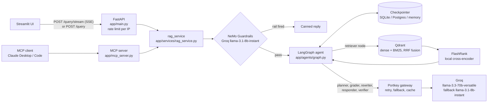
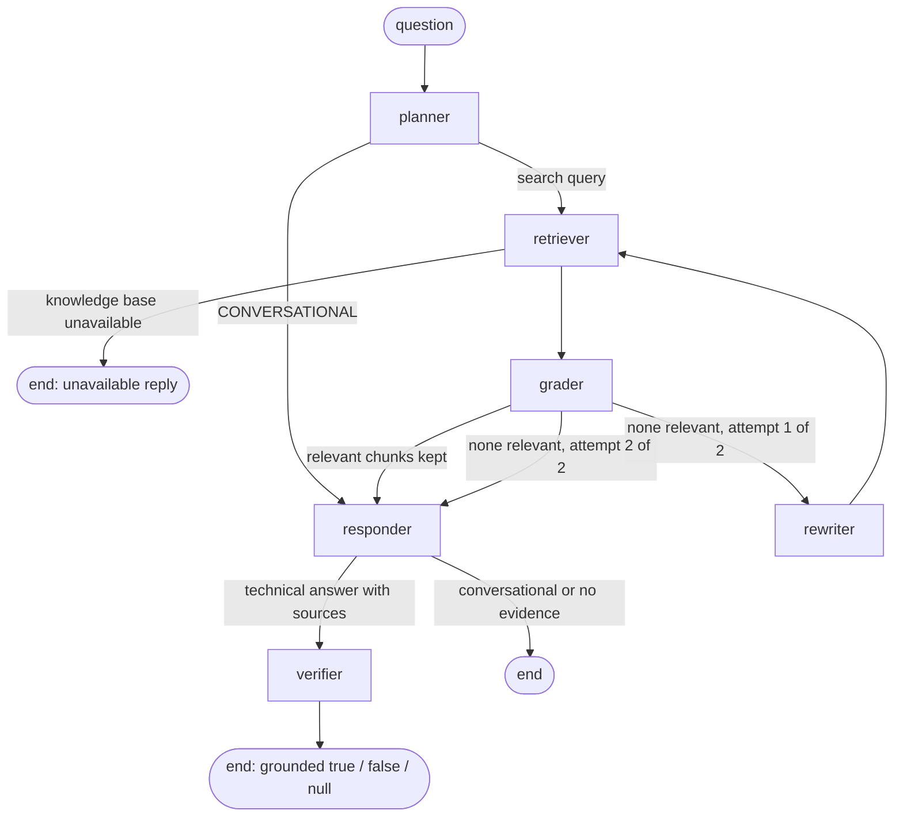

# Enterprise Agentic RAG

A self-correcting RAG service that answers technical questions from your own documents with inline citations and a groundedness check, and says so when the documents don't cover the question.

[](https://github.com/anilgehlotn/enterprise-agentic-rag/actions/workflows/ci.yml)

## What it does

You index PDF, HTML, TXT, DOCX and PPTX files (from the CLI or by uploading them), then ask questions through a Streamlit chat, the FastAPI API, or any MCP client such as Claude Desktop. Each question first passes NeMo Guardrails. A LangGraph agent then decides whether it needs the documents, searches Qdrant with hybrid dense + BM25 retrieval, reranks with FlashRank, grades the chunks for relevance, rewrites the query and retries once if nothing relevant came back, writes an answer that cites its sources as `[1]`, `[2]`, and finally checks that answer against the evidence. Answers stream to the UI token by token, and conversations are remembered per `thread_id` across restarts.

> **Live demo:** [anil-enterprise-rag.streamlit.app](https://anil-enterprise-rag.streamlit.app/)

## Key features

- **Self-correcting LangGraph agent** (Corrective RAG + Self-RAG): a batched LLM grader drops irrelevant chunks, a rewriter retries the search once with a new query, and a verifier labels the answer as supported or not supported by the sources. It can be switched off with `ENABLE_SELF_CORRECTION=false` to get the original planner → retriever → responder graph.
- **Hybrid retrieval**: Gemini dense vectors and BM25 sparse vectors live in one Qdrant collection and are fused server-side with Reciprocal Rank Fusion, then reranked by a local FlashRank cross-encoder (`RETRIEVAL_MODE=hybrid|dense`).
- **Citations and a groundedness badge**: every answer cites numbered sources that match the `sources` list in the response, and the UI shows "Verified against sources" or "Not fully supported by sources" based on the verifier's verdict.
- **Honest failure modes**: if nothing relevant is found after the retry, the agent returns a fixed "not in the indexed documents" reply instead of answering from general knowledge. If Qdrant or the embedding service is down, it says the knowledge base is unavailable instead of claiming there are no results.
- **NeMo Guardrails, fail-closed**: off-topic and jailbreak attempts are answered with a canned reply before any retrieval. If the guardrails can't initialise, the request returns an error rather than running unguarded.
- **MCP server**: three tools for MCP clients (ask, search, list documents). None of them uploads, changes or deletes documents.
- **Streaming**: `POST /query/stream` sends Server-Sent Events: plan steps as each graph node finishes, answer tokens as the LLM generates them, then the sources and a final `done` event.
- **Persistent conversation memory**: a LangGraph checkpointer stores each conversation by `thread_id`. It uses SQLite locally and can use Postgres on Cloud Run; `POST /threads/{thread_id}/reset` clears one conversation.
- **Rate limiting**: per-client-IP limits on `/query`, `/query/stream`, `/documents`, `/feedback` and `/analytics` (429 with `Retry-After`). `/health` is never limited.
- **Configurable chunking**: four strategies for ingestion (`paragraph` default, `fixed`, `recursive`, `semantic`) set with `CHUNKING_STRATEGY` / `CHUNK_SIZE` / `CHUNK_OVERLAP`. Each chunk's Qdrant payload records how it was chunked. A chunking experiment compares 18 configurations (see [Evaluation](#evaluation)).
- **Answer feedback and SQL analytics**: 👍/👎 under every answer (`POST /feedback`), and every question logged to `query_log` (SQLite locally, Postgres on Cloud Run) without answers or source text. `GET /analytics` (key-protected with `X-API-Key`) reports volume, intents, grounded rate, rewrite rate, satisfaction, frequent questions and latency from hand-written SQL (GROUP BY, HAVING, LEFT JOIN, CASE), with plain SQL migrations. A Streamlit analytics page (`ui/pages/analytics.py`) shows the same report. See [DOCS/14](DOCS/14_ANALYTICS.md).
- **CI/CD**: GitHub Actions runs ruff, pytest with a coverage gate, and a Docker build + `/health` smoke test. A manual workflow deploys to Cloud Run with Workload Identity Federation (no JSON keys) and Secret Manager.
- **Evaluation**: a RAGAS suite (5 metrics plus tool correctness) and guardrail precision/recall over a golden dataset, a retrieval benchmark comparing dense, hybrid and reranked retrieval, and a chunking experiment.

## Architecture

### Request flow



Both the API and the MCP server call the same `rag_service` functions, so the guardrails, state reset and response shape are identical for every entry point. Query embeddings go directly to Gemini, not through Portkey.

### Agent graph

Node names match `app/agents/graph.py`.



The retriever fetches 15 candidates and FlashRank keeps the top 5. With no relevant chunks after the second attempt, the responder returns the fixed "not in the indexed documents" reply without an LLM call, and the verifier is skipped. Cost per technical question: planner + grader + responder + verifier LLM calls (plus a rewriter call, a second retrieval and a second grading when the first attempt finds nothing).

More diagrams, including ingestion, evaluation and observability: [ARCHITECTURE.md](ARCHITECTURE.md).

## Tech stack

| Layer | Technology |
|---|---|
| API | FastAPI 0.136, uvicorn, Pydantic 2 |
| Agent | LangGraph 1.1 (`StateGraph`, checkpointers, `updates` + `custom` stream modes) |
| LLMs | Groq `llama-3.3-70b-versatile` (fallback `llama-3.1-8b-instant`) through the Portkey gateway (`portkey-ai` 2.3) |
| Guardrails | NVIDIA NeMo Guardrails 0.21 with Groq `llama-3.1-8b-instant` |
| Embeddings | Gemini `gemini-embedding-2-preview` (3072-dim dense), fastembed `Qdrant/bm25` (sparse) |
| Vector DB | Qdrant Cloud (`qdrant-client` 1.17), named `dense` + `bm25` vectors, native RRF fusion |
| Reranker | FlashRank 0.2 (`ms-marco-TinyBERT-L-2-v2`, ONNX, CPU) |
| Memory | `langgraph-checkpoint-sqlite` / `langgraph-checkpoint-postgres` (psycopg 3 pool) |
| MCP | Official `mcp` Python SDK 2.3 (stdio and streamable HTTP) |
| UI | Streamlit |
| Observability | Pydantic Logfire, LangSmith |
| Evaluation | RAGAS (judge: Groq `llama-3.1-8b-instant`), custom retrieval metrics |
| Delivery | Docker (multi-stage, non-root, models baked in), GitHub Actions, Cloud Run, Secret Manager |

Exact versions: [requirements-prod.txt](requirements-prod.txt) (container), [requirements-dev.txt](requirements-dev.txt) (CI), [requirements.txt](requirements.txt) (full local install including evals).

## Quickstart

Requires Python 3.11+.

**1. Install**

```bash
python -m venv .venv
source .venv/bin/activate          # Windows: .venv\Scripts\activate
pip install -r requirements.txt
```

**2. Configure**

```bash
cp .env.example .env
```

Fill in at least `GROQ_API_KEY` (guardrails), `PORTKEY_API_KEY` (agent LLM calls; the Groq keys themselves are configured as the `rag` and `brag` integrations in the Portkey dashboard), `GEMINI_API_KEY`, `QDRANT_CLUSTER_ENDPOINT` and `QDRANT_API_KEY`. Every variable is described in [.env.example](.env.example) and [DOCS/05_ENVIRONMENT_VARIABLES.md](DOCS/05_ENVIRONMENT_VARIABLES.md). Never commit `.env`.

**3. Ingest the sample corpus**

```bash
python -m app.ingestion.processor DATA --wipe
```

Sub-folders become source types (`DATA/true_data` → `true`, `DATA/noisy_data` → `noisy`). `--wipe` drops and recreates the collection named by `QDRANT_COLLECTION`. It is required once for a collection created before hybrid search.

`DATA/noisy_data` (the distractor corpus) is **not** distributed with this repository, because those documents are third-party material. A missing folder is skipped with a message, so this command works with `true_data` alone. [DATA/README.md](DATA/README.md) explains what the corpus is, how to supply your own distractors, and what their absence does to the noise-rate metric.

**4. Run the API and the UI**

```bash
uvicorn app.main:app --reload --port 8000     # terminal 1
streamlit run ui/app.py                       # terminal 2 (uses BACKEND_URL, default http://localhost:8000)
curl http://localhost:8000/health             # {"status":"ok","service":"enterprise-agentic-rag"}
```

Conversations are stored in `state/checkpoints.sqlite` under the project root by default (`CHECKPOINTER=sqlite`).

**5. Run the checks** (no API keys or network needed)

```bash
pip install -r requirements-dev.txt
ruff check . && ruff format --check .
python -m pytest tests -q --cov=app
```

## Configuration

All settings come from environment variables (`.env` locally, Secret Manager on Cloud Run). The full list with defaults is in [DOCS/05_ENVIRONMENT_VARIABLES.md](DOCS/05_ENVIRONMENT_VARIABLES.md) and [.env.example](.env.example). The ones most often changed:

| Variable | Default | Purpose |
|---|---|---|
| `QDRANT_COLLECTION` | `enterprise_rag` | Collection to index into and search |
| `RETRIEVAL_MODE` | `hybrid` | `hybrid` (dense + BM25 with RRF) or `dense` |
| `CHUNKING_STRATEGY` | `paragraph` | `paragraph`, `fixed`, `recursive` or `semantic`. Invalid values fail at API startup and before `processor --wipe` touches Qdrant. Re-ingest after changing it. |
| `CHUNK_SIZE` | `1500` | Maximum chunk length in characters |
| `CHUNK_OVERLAP` | `0` | Characters repeated between chunks; must be smaller than `CHUNK_SIZE`. Only `fixed` and `recursive` support it. |
| `ENABLE_SELF_CORRECTION` | `true` | `false` runs the linear planner → retriever → responder graph |
| `CHECKPOINTER` | `sqlite` | Conversation memory: `memory`, `sqlite` or `postgres` |
| `RATE_LIMIT_QUERY` / `RATE_LIMIT_UPLOAD` | `20/minute` / `5/minute` | Per-IP limits |
| `ANALYTICS_ENABLED` | `true` | Log one row per question and accept `POST /feedback`; `false` logs nothing and `query_id` is `null` |
| `ANALYTICS_DATABASE_URL` | SQLite file `state/analytics.sqlite` | SQLAlchemy URL of the analytics database (Postgres on Cloud Run) |
| `ANALYTICS_STORE_QUESTIONS` | `true` | `false` stores `NULL` instead of the question text |
| `ANALYTICS_API_KEY` | empty | Key for `GET /analytics`; empty means the endpoint returns 404 |

## API endpoints

| Method | Path | Purpose |
|---|---|---|
| `GET` | `/` | Liveness message |
| `GET` | `/health` | Readiness check for Docker and Cloud Run. Never rate limited. |
| `GET` | `/graph` | PNG of the agent graph (rendered through the mermaid.ink web API, so it needs network access) |
| `POST` | `/query` | Ask a question: `{"q": "...", "thread_id": "..."}` → `question, answer, thought_process, status, sources, grounded, query_id` (`query_id` is `null` when analytics is off) |
| `POST` | `/query/stream` | Same body and pipeline as `/query`, streamed as SSE events `step`, `token`, `sources`, `done` (or `error`) |
| `POST` | `/documents` | Upload and index files (multipart `files`; PDF/HTML/TXT/DOCX/PPTX, 25 MB per file) → 201 with `filename, chunks_indexed` per file |
| `POST` | `/threads/{thread_id}/reset` | Delete a conversation's memory |
| `POST` | `/feedback` | Rate an answer: `{"query_id": "...", "rating": 1 or -1, "comment": "..."}` → 201 (a second vote replaces the first); 404 for an unknown `query_id` |
| `GET` | `/analytics?days=7` | Query analytics for 1–90 days. Needs `X-API-Key: $ANALYTICS_API_KEY`; returns 404 when no key is configured |

`q` is 1–4,000 characters. `/query` and `/query/stream` share one rate-limit budget (`RATE_LIMIT_QUERY`, default `20/minute`); `/documents` has its own (`RATE_LIMIT_UPLOAD`, default `5/minute`); `/feedback` and `/analytics` each have their own budget with the `RATE_LIMIT_QUERY` limit. FastAPI's interactive docs are at `/docs`.

## MCP server

```bash
python -m app.mcp_server                                                  # stdio (Claude Desktop / Claude Code)
python -m app.mcp_server --transport http --host 127.0.0.1 --port 8001    # streamable HTTP at /mcp
```

Tools: `ask_knowledge_base` (guardrails + the full agent; returns a cited answer and the groundedness verdict), `search_knowledge_base` (reranked evidence, no LLM call) and `list_indexed_documents`. They have no authentication, so the HTTP transport binds to localhost by default. Setup for Claude Desktop, Claude Code and MCP Inspector: [DOCS/13_MCP_SERVER.md](DOCS/13_MCP_SERVER.md).

## Evaluation

All three evaluations use the golden dataset in [`evals/golden_dataset.json`](evals/golden_dataset.json): 15 questions built from the `DATA/true_data` documents and 6 guardrail test inputs. With 15 questions, one question moves hit rate by 6.7 points, so small differences are noise.

| Evaluation | What it measures | Results |
|---|---|---|
| Chunking experiment | Retrieval quality of 18 chunking configurations | [Published](evals/results/chunking_experiment.md) (2026-11-07 run) |
| Retrieval benchmark | Dense vs hybrid retrieval, with and without FlashRank | Not published yet |
| RAGAS suite | Answer quality of the full agent, plus guardrail precision/recall | Not published yet |

### Chunking experiment

`evals/chunking_experiment.py` compares the four chunking strategies (`paragraph`, `fixed`, `recursive`, `semantic`) at chunk sizes 500, 1000 and 1500, with and without 15% overlap. Each configuration is indexed into a temporary in-memory Qdrant and searched with the production hybrid + FlashRank pipeline. The published run used a **local `sentence-transformers/all-MiniLM-L6-v2` embedder** (not the production Gemini model) and the **15 golden questions**, so it compares configurations against each other; absolute numbers will differ in production. It needs no API keys.

Headline findings, quoted from [`evals/results/chunking_experiment.md`](evals/results/chunking_experiment.md):

- **Chunk size is the clearest effect.** Mean over strategies at 500 / 1000 / 1500: MRR 0.704 / 0.815 / 0.885, hit rate 0.84 / 0.94 / 0.99, coverage 0.78 / 0.88 / 0.94.
- **Overlap: no consistent benefit at this sample size, at a fixed cost.** The cost is certain: +16–17% chunks, embeddings and vector storage.
- **Semantic chunking costs the most and wins nothing here.** It has the lowest mean MRR (0.733).
- **Best configuration: `fixed / 1500 / 225`** (MRR 0.967, hit 1.00). It is **not distinguishably better than the current default `paragraph / 1500 / 0`** (MRR 0.900, hit 1.00): ΔMRR −0.067, 95% CI [−0.17, +0.00]. Recommendation: **Keep the current default, `paragraph / 1500 / 0`.** It ties for the best hit rate (1.00), sits within noise of the top MRR, embeds the fewest characters and needs no overlap.

```bash
python -m evals.chunking_experiment            # full grid, 18 configurations
python -m evals.chunking_experiment --quick    # 8 configurations
```

### Retrieval benchmark

`evals/retrieval_benchmark.py` compares dense only, dense + FlashRank, hybrid (RRF) and hybrid + FlashRank on the 15 golden questions against the live Qdrant collection. It reports hit rate@5, MRR@5, noise rate@5 (share of top-5 chunks from the distractor corpus) and latency. **It has not been run against the current collection, so no results are published.** Running it needs the Gemini and Qdrant keys; it prints the table and writes `evals/results/retrieval_benchmark.md`:

```bash
python -m evals.retrieval_benchmark              # --delay 3 if Gemini rate-limits (default 1.5 s)
```

### RAGAS suite

The suite calls the live API for each golden question, then scores the answers with RAGAS Faithfulness, Answer Relevancy, Context Precision, Context Recall and Answer Correctness. The judge is Groq `llama-3.1-8b-instant` with its own `JUDGE_GROQ` key. It also computes a deterministic tool-correctness score (Jaccard overlap of the expected and detected route). Guardrail cases are scored as TP/TN/FP/FN with precision and recall. Scoring is paced for Groq's free tier and takes about 50 minutes. **No RAGAS report has been published yet.** Details: [DOCS/11_EVALS_PIPELINE.md](DOCS/11_EVALS_PIPELINE.md).

```bash
uvicorn app.main:app --port 8000     # terminal 1
streamlit run evals/app.py           # terminal 2: ground truth, live pipeline, eval metrics tabs
```

## Tests and quality

| Check | Result |
|---|---|
| Tests | 510 passed, in 24 test files, with no API keys or network |
| Line coverage of `app/` | 89% (CI fails below 75%) |
| Lint and format | `ruff check` and `ruff format --check`, run in CI |

Test count and coverage are from `python -m pytest tests -q --cov=app` in the CI environment (`requirements-dev.txt`) on 2026-11-07.

## Engineering decisions

- **The grader fails open; the guardrails fail closed.** If the relevance grader's output can't be parsed or its call fails, all chunks are kept, because a flaky grader must never throw away evidence. If guardrails can't initialise, the request returns an error, because an unguarded request is worse than a failed one.
- **Retries are capped.** The corrective loop allows the first retrieval plus one rewrite (`MAX_RETRIEVAL_ATTEMPTS = 2`). After that the answer is a fixed, LLM-free "not in the documents" reply. This bounds cost and latency, and it stops the model from falling back to general knowledge.
- **RRF instead of adding scores.** Cosine similarities and BM25 scores live on different, unbounded scales, so adding them requires fragile normalisation. Reciprocal Rank Fusion only uses ranks, and Qdrant runs it server-side in a single `query_points` call.
- **The MCP tools never change the knowledge base.** No upload or delete tool is exposed, errors returned to clients are generic, and the HTTP transport binds to localhost and logs a warning on any other address. `ask_knowledge_base` does store conversation memory for its `thread_id`.
- **Postgres for memory on Cloud Run, SQLite locally.** A Cloud Run container's disk is in memory, wiped on scale-down and not shared between instances, so the checkpointer there must be a shared database. The backend is one environment variable (`CHECKPOINTER`), and an invalid value fails at startup.
- **uv for the production image.** pip's backtracking resolver gave up (`ResolutionImpossible`) on `requirements-prod.txt` because of logfire's OpenTelemetry pins. uv resolves the same pins in seconds.
- **X-Forwarded-For is trusted only behind our proxy.** Any client can forge the header, so rate limits use the TCP peer address unless `TRUST_PROXY_HEADERS=true`. Even then they use only the rightmost entry, the one the proxy appended. The container runs uvicorn with `--no-proxy-headers` so uvicorn doesn't rewrite the client address on its own.

## Repository map

```text
app/
  main.py                 FastAPI app: lifespan, endpoints, SSE formatting
  services/rag_service.py Shared guardrails → agent logic for the API and MCP (answer, stream, reset)
  agents/
    graph.py              StateGraph wiring, get_rag_agent()
    routing.py            Pure routing decisions and LLM-output parsers (no I/O)
    state.py              AgentState and the per-request state reset
    checkpointer.py       memory / sqlite / postgres checkpointer factory
    streaming.py          Token streaming from nodes via LangGraph's stream writer
    nodes/                planner, retriever, grader, rewriter, responder, verifier
  services/retrieval/     Qdrant hybrid search, Gemini + BM25 embeddings, FlashRank, citations
  ingestion/              Loaders (PDF/HTML/TXT/DOCX/PPTX), chunker, processor (CLI + uploads)
  guardrails/             NeMo Colang rules and the guard() gate
  gateway/                Portkey config, native and LangChain clients, cache-status helper
  analytics/              Query log + feedback: SQL migrations, background writer, hand-written analytics SQL
  rate_limit.py           Sliding-window per-IP limiter
  mcp_server.py           MCP server (3 tools)
ui/app.py                 Streamlit chat (SSE streaming with /query fallback), upload dialog, 👍/👎 feedback
ui/pages/analytics.py     Streamlit analytics page (GET /analytics)
evals/                    Golden dataset, RAGAS pipeline + dashboard, retrieval benchmark, chunking experiment
tests/                    Unit and API tests (no keys, no network)
notebooks/                Guardrails, gateway and evals experiments
DATA/                     Sample corpus: true_data (answers); noisy_data (distractors) not distributed
processed_data/           Parsed chunks written by ingestion (read by list_indexed_documents)
DOCS/                     Guides, listed below
Dockerfile                Multi-stage production image for Cloud Run
.github/workflows/        ci.yml (lint, test, docker) and deploy-cloud-run.yml (manual)
```

## What I built

Work added in this repository:

- **Bug fixes**: production image dependencies (Gemini embeddings; DOCX/PPTX parsing without `unstructured`; pdfplumber), the first upload into an empty Qdrant collection, citation scores in the API response, eval pipeline crashes, and planner output parsing.
- **Document upload**: `POST /documents` with type and size validation, and the Streamlit upload dialog.
- **Self-correcting agent**: relevance grader, one query rewrite and retry, answer verifier, inline `[n]` citations, and the fixed "not in the documents" reply.
- **Hybrid retrieval**: dense + BM25 vectors fused with RRF, the "knowledge base unavailable" path, and the retrieval benchmark.
- **MCP server** with three tools for MCP clients.
- **SSE streaming** (`/query/stream`), **persistent memory** (SQLite / Postgres checkpointer with thread reset) and **per-IP rate limiting**.
- **CI/CD**: ruff, pytest with a coverage gate, and a Docker build + `/health` smoke test on every push; a rebuilt production image (multi-stage, non-root, installed with uv because pip could not resolve the pinned requirements); and a manual Cloud Run deploy workflow using Workload Identity Federation and Secret Manager.
- **Chunking strategies and the chunking experiment**: `fixed`, `recursive` and `semantic` chunkers next to the default `paragraph` chunker, configured with `CHUNKING_STRATEGY` / `CHUNK_SIZE` / `CHUNK_OVERLAP`, and an experiment that compares 18 configurations on the golden questions.
- **Feedback and SQL analytics**: 👍/👎 feedback (`POST /feedback`), a query log, and `GET /analytics` backed by hand-written SQL with plain SQL migrations, plus a Streamlit analytics page.
- **Test suite**: from 2 test files at the start to 24 files (510 tests) that run without API keys or network.

## Documentation

| Guide | Topic |
|---|---|
| [ARCHITECTURE.md](ARCHITECTURE.md) | System diagrams |
| [01 System overview](DOCS/01_SYSTEM_OVERVIEW.md) | Request flow at a glance |
| [02 Ingestion engine](DOCS/02_INGESTION_ENGINE.md) | Parsing, chunking, dense + BM25 indexing |
| [03 Node intelligence](DOCS/03_NODE_INTELLIGENCE.md) | Each agent node and the corrective loop |
| [04 Tracing and observability](DOCS/04_TRACING_AND_OBSERVABILITY.md) | Logfire and LangSmith |
| [05 Environment variables](DOCS/05_ENVIRONMENT_VARIABLES.md) | Every setting |
| [06 Known gotchas](DOCS/06_KNOWN_GOTCHAS.md) | Logfire init order, lazy loading |
| [07 FlashRank and hybrid retrieval](DOCS/07_FLASHRANK_RERANKING.md) | RRF fusion and reranking |
| [08 Guardrails](DOCS/08_GUARDRAILS.md) | NeMo Guardrails concepts and implementation |
| [09 LLM gateway](DOCS/09_LLM_GATEWAY.md) | Portkey concepts and implementation |
| [10 Evals](DOCS/10_EVALS.md) | Evaluation concepts and RAGAS |
| [11 Evals pipeline](DOCS/11_EVALS_PIPELINE.md) | How this project's eval run works |
| [12 Deployment and demo](DOCS/12_DEPLOYMENT_AND_DEMO.md) | CI, Docker, Cloud Run, Postgres memory, rate limits |
| [13 MCP server](DOCS/13_MCP_SERVER.md) | MCP tools and client setup |
| [14 Analytics](DOCS/14_ANALYTICS.md) | Query log and feedback schema, every analytics SQL query, privacy, sqlite3 CLI |
| [Project guide](DOCS/PROJECT_GUIDE.md) | Beginner-friendly walkthrough and interview prep |
| [Roadmap](DOCS/ROADMAP.md) | Planned work: phases, dependencies and a section per open issue |
| [Sample corpus](DATA/README.md) | What is in `DATA/`, where it came from, and how to supply your own distractors |
| [CONTRIBUTING.md](CONTRIBUTING.md) | Setup, checks, conventions and architecture rules |

## Contributing

Contributions are welcome. See [CONTRIBUTING.md](CONTRIBUTING.md) for setup, the checks to run and the architecture rules. Security problems should be reported privately, as described in [SECURITY.md](SECURITY.md); contributors are expected to follow the [code of conduct](CODE_OF_CONDUCT.md).

## License

**No open-source licence has been applied yet.** Part of the code in this repository is adapted from a project that carries no licence of its own, so a licence cannot be granted for it. My own additions will be released under the MIT licence once that is resolved. Until then, no permissions beyond those granted by copyright law are given.

The documents under [DATA/](DATA/README.md) and the reference material in `DOCS/` are not mine either: each belongs to its own author or publisher and is kept for development and evaluation only.

## Acknowledgements

The initial pipeline (ingestion, a basic planner → retriever → responder agent, Qdrant search, guardrails, gateway, UI and evaluation notebooks) was adapted from this [8-hour Enterprise Agentic RAG tutorial](https://www.youtube.com/watch?v=bjkjaqUZl4E) and its [source repository](https://github.com/d-hackmt/8hr-MARATHON).
